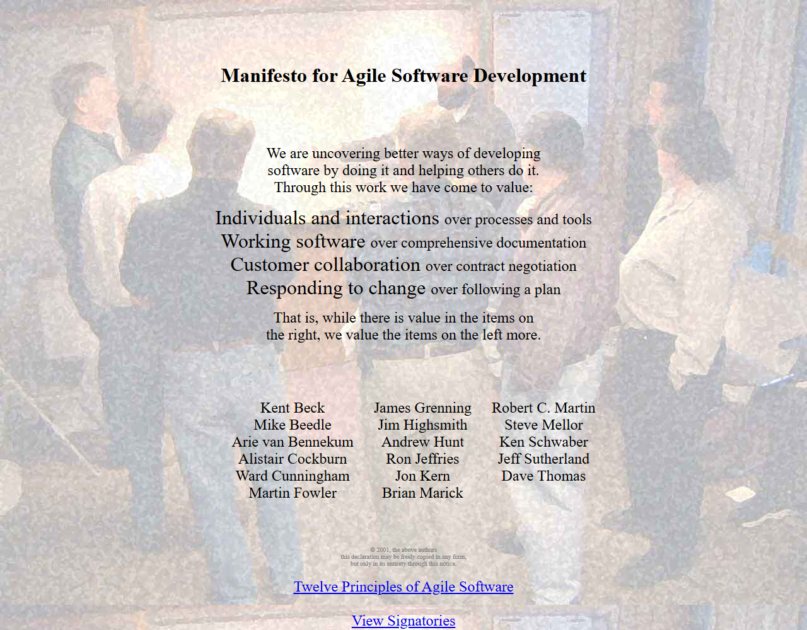
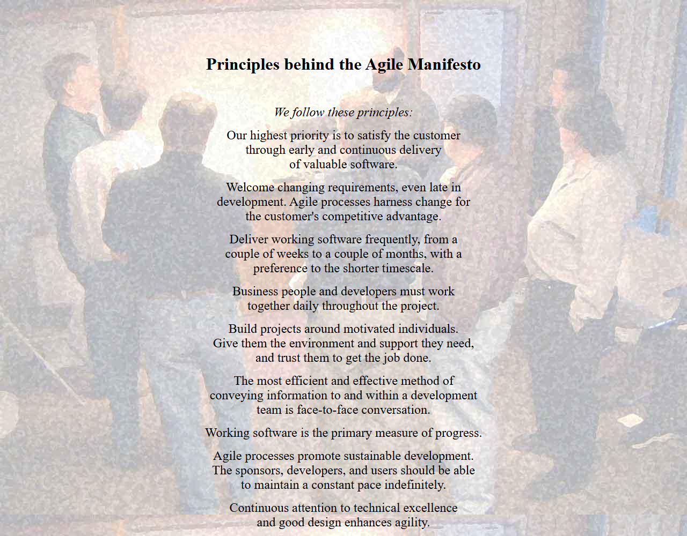

# Agile Principles & Frameworks  

**Milestone:** 0  
**Issue Number:** #6  
**Date:** 21/10/2026  

## What Is Agile?

- Agile is a way of building software in **small pieces**, getting **feedback often**, and **adjusting the plan** as we learn.
- **Traditional (Waterfall) project management:**
  - Plans everything up front, then goes step by step: requirements → design → build → test → release.
  - Changes late in the project are expensive.
  - Users often only see the product at the very end.
- **Agile:**
  - Delivers working software early and keeps improving it.
  - Expects requirements to change and treats change as normal.
  - Relies on close teamwork and regular feedback instead of long documents and fixed contracts.

## Core Values of the Agile Manifesto

- The Agile Manifesto (2001) values:
  - **Individuals and interactions** over processes and tools
  - **Working software** over comprehensive documentation
  - **Customer collaboration** over contract negotiation
  - **Responding to change** over following a plan
- The things on the right still matter. Agile just values the things on the left **more**.

## Core Principles (in short)

- Satisfy the customer with **early and continuous delivery** of valuable software.
- **Welcome changing requirements**, even late.
- **Deliver working software frequently**, preferring shorter timescales.
- Business people and developers **work together** daily.
- Build projects around **motivated people**, and trust them.
- **Face-to-face conversation** (or the closest remote version, like a call) is the best way to share information.
- **Working software** is the main measure of progress.
- Keep a **sustainable pace** the team can maintain.
- Pay continuous attention to **technical excellence and good design**.
- **Simplicity**: maximise the amount of work *not* done.
- **Self-organising teams** produce the best designs.
- The team regularly **reflects and adjusts** how it works.

## Scrum vs Kanban (in my own words)

- **Scrum**
  - Work happens in fixed **sprints**, usually 1–4 weeks.
  - The team commits to a set of work at **Sprint Planning** and tries not to change it mid-sprint.
  - Has set roles: **Product Owner**, **Scrum Master** and **Developers**.
  - Has set ceremonies: Sprint Planning, Daily Stand-up, Sprint Review and Retrospective.
  - Progress is measured per sprint (velocity, burndown).
- **Kanban**
  - **No sprints.** Work flows continuously across a board (e.g. To Do → In Progress → Review → Done).
  - Priorities can change any time. The next most important item is just pulled from the top of the backlog.
  - Uses **WIP limits** (work in progress) so people don't start too many things at once.
  - No required roles. Teams keep the roles they already have.
  - Progress is measured by flow: how long items take to go from start to done.
- **When each is used:**
  - **Scrum** suits teams building a planned product where a stable 2-week plan is realistic.
  - **Kanban** suits teams with **changing priorities, interruptions, support work and continuous releases**.

## Why Focus Bear Leans Towards Kanban

- Focus Bear is a small team shipping an app on several platforms (desktop and mobile), where priorities can change quickly: user feedback, bug reports, app store updates.
- Kanban lets the team **re-prioritise any day** without waiting for a sprint to end.
- Work can be **released continuously** as soon as it's ready and reviewed.
- Team members often work **remotely and across time zones**. A shared board makes everyone's status visible without needing everyone in the same meeting.
- I see this in my own onboarding: each task is a **GitHub issue** that I pick up, work on, get reviewed (by the review bot), and close. There's no sprint; each item flows through on its own.

## Reflection

### What do you think are the biggest benefits and challenges of Agile?

- **Benefits:**
  - Users get value sooner, and the team gets feedback early.
  - Mistakes are found early, when they're cheap to fix.
  - Easy to change direction when priorities change.
  - Progress is visible to everyone (board, stand-ups).
- **Challenges:**
  - Needs **discipline**: without planning, "flexible" can become chaotic.
  - Needs good **communication**, which is harder when everyone is remote.
  - Constant change can lead to unfinished work or technical debt if it isn't managed.
  - Less documentation up front, so new people (like interns) can find it harder to get context.

### How can Agile principles help improve my role and responsibilities?

- **Small, frequent deliveries:** finishing and submitting one issue at a time gets me review feedback faster than doing many things at once.
- **Responding to change:** when the review bot asks for changes, I treat it as normal feedback and update my work quickly.
- **Working software as progress:** for my backend tasks, that means running code, passing tests and real output (screenshots), not just written explanations.
- **Reflect and adjust:** after each rejected issue, I learn what reviewers expect (clear evidence, direct answers) and apply it to the next one.

## Task

### Main differences between Scrum and Kanban (summary)

- Scrum works in **fixed sprints**. Kanban is a **continuous flow**.
- Scrum **locks scope** for the sprint. Kanban lets priorities **change anytime**.
- Scrum has **set roles and ceremonies**. Kanban is lighter and keeps existing roles.
- Scrum tracks **velocity per sprint**. Kanban tracks **flow and WIP limits**.

### One Agile principle most useful in my work

- **"Working software is the primary measure of progress."**
- As a backend intern, my work only counts when it actually runs: the API responds, tests pass, and I can show proof.
- This principle keeps me focused on getting things working end-to-end and providing clear evidence, instead of writing a lot without showing results.
