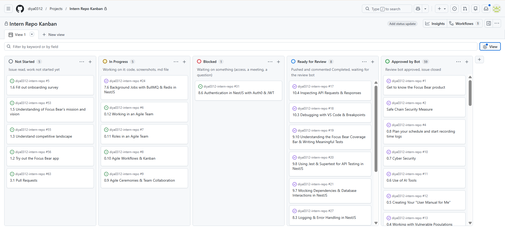
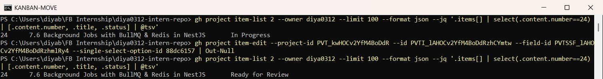
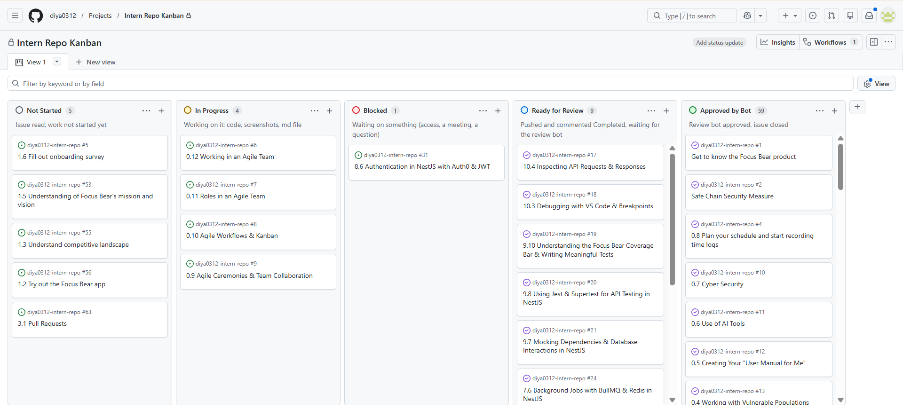

# Agile Workflows & Kanban  

**Milestone:** 0  
**Issue Number:** #8  
**Date:** 21/10/2026  

## How a Kanban Board Works

- A Kanban board shows work as **cards** (tasks) moving through **columns** (stages).
- Anyone can see at a glance **what's being worked on, what's stuck, and what's done**.
- Work is **pulled**: when someone finishes a card, they pull the next most important one, instead of being assigned a big batch up front.
- **How it helps manage workflow:**
  - Makes bottlenecks visible, e.g. lots of cards piling up in "Review".
  - Keeps priorities clear, because the top of the backlog is the most important.
  - Reduces status meetings, because the board **is** the status.

## What the Columns Represent

- **Backlog / Not Started:** tasks that are ready but nobody has started yet.
- **In Progress:** someone is actively working on it.
- **Blocked:** started, but waiting on something outside the person's control (access, an answer, another task).
- **Ready for Review:** the work is finished and waiting for someone to check it.
- **Done / Approved:** reviewed and accepted.

## How Tasks Move and Who Updates Them

- Cards move **left to right**: Not Started → In Progress → (Blocked, if needed) → Ready for Review → Done.
- **The person doing the task moves their own card** as soon as its status changes. Reviewers move it to Done once it's approved.
- If review asks for changes, the card goes **back** to In Progress.
- An up-to-date board only works if everyone updates their cards straight away.

## Benefits of Limiting Work in Progress (WIP)

- **Finishing over starting:** fewer half-done tasks, and more tasks actually reach Done.
- **Less context switching:** jumping between many tasks wastes time and causes mistakes.
- **Bottlenecks show up quickly:** if a column hits its limit, the team helps clear it instead of starting new work.
- **Faster flow:** each task gets from start to finished faster, so feedback comes sooner.

## My Kanban Board

- I created a GitHub Projects board, **Intern Repo Kanban**, linked to my `diya0312-intern-repo` repository.
- I set up these columns for my onboarding workflow:
  - **Not Started:** issue read, work not started yet
  - **In Progress:** working on it (code, screenshots, md file)
  - **Blocked:** waiting on something (access, a meeting, a question)
  - **Ready for Review:** pushed and commented "Completed", waiting for the review bot
  - **Approved by Bot:** the review bot approved it and the issue is closed
- I added all my issues and placed each one by its **real** status:
  - closed issues the bot approved → **Approved by Bot** (59)
  - issues I resubmitted that the bot hasn't reviewed yet → **Ready for Review**
  - #31 Auth0 is waiting for an Auth0 access token → **Blocked**
  - the milestone 0 agile issues I'm writing now → **In Progress**
  - issues I haven't started → **Not Started**

## Moving a Task Through the Board

- **Task:** #24 *7.6 Background Jobs with BullMQ & Redis*.
- It was in **In Progress** while I added the retry evidence the bot asked for.
- After pushing the update and commenting on the issue, I moved it to **Ready for Review** with the GitHub CLI:
  - `gh project item-list` showed `In Progress`
  - `gh project item-edit ... --single-select-option-id <Ready for Review>` moved the card
  - `gh project item-list` then showed `Ready for Review`
- When the review bot approves it, it moves to **Approved by Bot**. If the bot asks for changes, it goes back to **In Progress**.

## Reflection

### How does Kanban help manage priorities and avoid overload?

- The **Not Started** column is my priority list. I always pull from the top instead of picking randomly.
- Seeing everything **In Progress** in one place shows when I've started too many things. Then I finish those before starting new ones.
- The **Blocked** column stops waiting tasks from silently eating my time. I can switch to another task and come back when unblocked.
- **Ready for Review** shows how much is waiting on feedback, so I can follow up on reviews instead of only starting new work.

### How can I improve my workflow using Kanban principles?

- **Limit my WIP:** at most **2 issues In Progress** at a time, so I finish and submit them instead of having many half-done issues.
- **Move cards right away:** update the board when I start, get blocked, submit, or get reviewed.
- **Use Blocked honestly:** if I'm waiting on access, a meeting or a question, mark it Blocked and say what I'm waiting for.
- **Check Ready for Review daily:** if the bot rejects an issue, move it straight back to In Progress and fix it first, before starting new issues.

## Task: One Way to Improve Task Tracking in My Role

- **Link the board status to my real steps:** I'll move a card to **Ready for Review** only after I've:
  - pushed the work
  - checked that every screenshot in the md file exists on GitHub
  - commented on the issue
- Some of my issues were rejected because of missing or mismatched evidence. Making "all evidence visible on GitHub" part of the definition of **Ready for Review** will cut down rejections and make my board status accurate.
