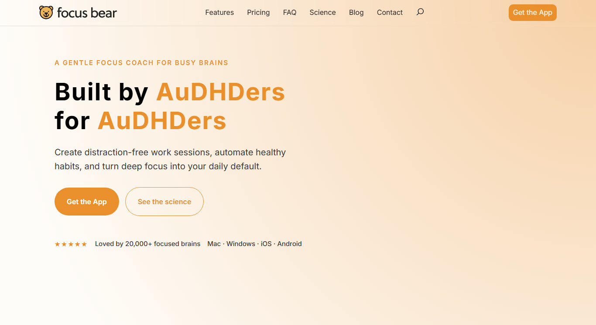

# Understanding Focus Bear's Mission & Vision  

**Milestone:** 1  
**Issue Number:** #53  
**Date:** 23/10/2026  

## What I Found on the Focus Bear Website

- Focus Bear describes itself as **"a gentle focus coach for busy brains"**.
- It is **"Built by AuDHDers for AuDHDers"**, meaning by and for people with ADHD and autism.
- It aims to help people create distraction-free work sessions, automate healthy habits, and make deep focus part of their daily routine.

## Reflection

### Why do you think Focus Bear was created?

- I think Focus Bear was built to help its users **focus on their work without getting distracted**.
- It is mainly aimed at **neurodivergent users** with ADHD, ASD (autism), dyslexia and similar conditions, and helps them focus with built-in features like **routines** and **blocking distracting sites**.
- But the app can be used by **everyone** who finds it hard to stay focused sometimes, including me. I sometimes find it hard to focus on my work, and Focus Bear helps me focus much better by blocking unwanted sites and with features like the focus music.

### What problem is Focus Bear solving?

- Focus Bear is solving the problem of **distractions**.
- It helps people **calmly focus on their work** without getting distracted.
- It also helps people **form routines**, which helps the brain build certain patterns. This avoids confusion and makes the whole process more peaceful.

### Why do you think this mission is important?

- For some people, especially neurodivergent people, **overwhelming noises and colours** can be disturbing, which makes it very hard to focus.
- It's usually better to give them a **peaceful environment** where they can do their work properly without disturbances, and that's exactly what Focus Bear helps with.
- It helps people **stay focused** and also **reminds them to take breaks** in between.
- Most importantly, it helps them build **routine patterns**, which keeps their day scheduled and predictable.

### How does Focus Bear's work align with my personal values or interests?

- It helps me **keep myself away from distracting sites** that I'm often drawn to when studying or doing project work, like **YouTube** and **gaming sites**. I can spend a lot of time on these if I get distracted.
- With Focus Bear I can do my work **peacefully**, without getting distracted, and it also helps me **take breaks** in between.
- I value being able to work calmly and productively, and Focus Bear supports that.

### Do I personally relate to any of the challenges that Focus Bear aims to solve?

- **Yes, with distraction.** I sometimes find it hard to focus on my work, and I easily get pulled into YouTube or games. Focus Bear's blocking and focus music help me stay on track.
- **About ADHD and autism:** I don't personally know anyone with ADHD or autism, but I've heard people talk about it and have watched a few documentaries about how difficult it can be for them to focus.
- **How Focus Bear could help someone like that:**
  - It gives them a **calm, distraction-free space** to work in.
  - It **reminds them to take breaks**.
  - It helps them **build routines**, so their day stays scheduled without too many unexpected changes.
