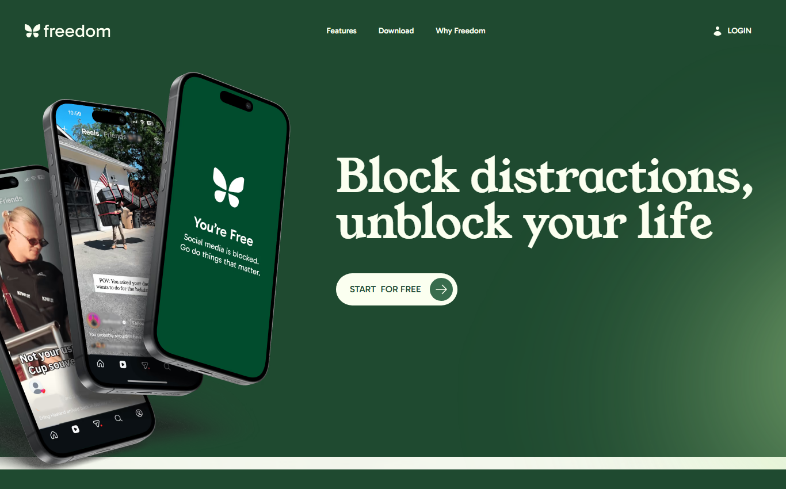
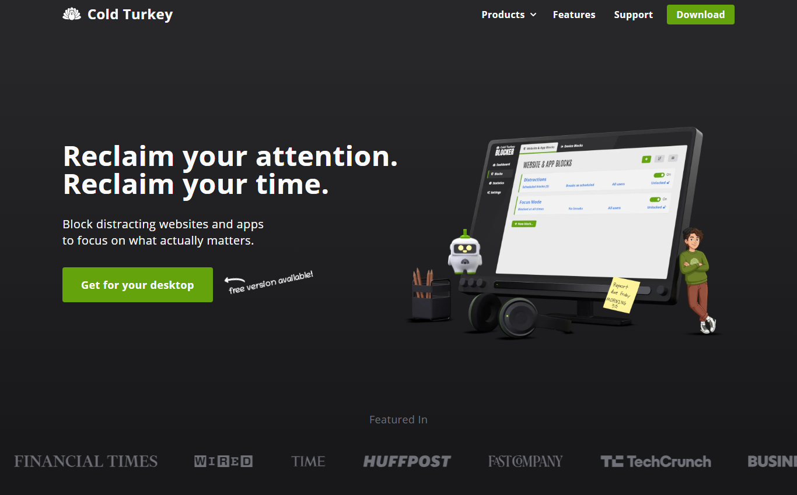
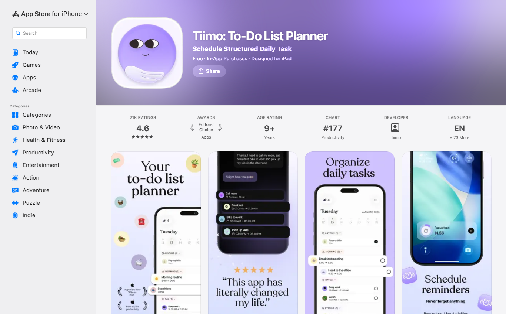
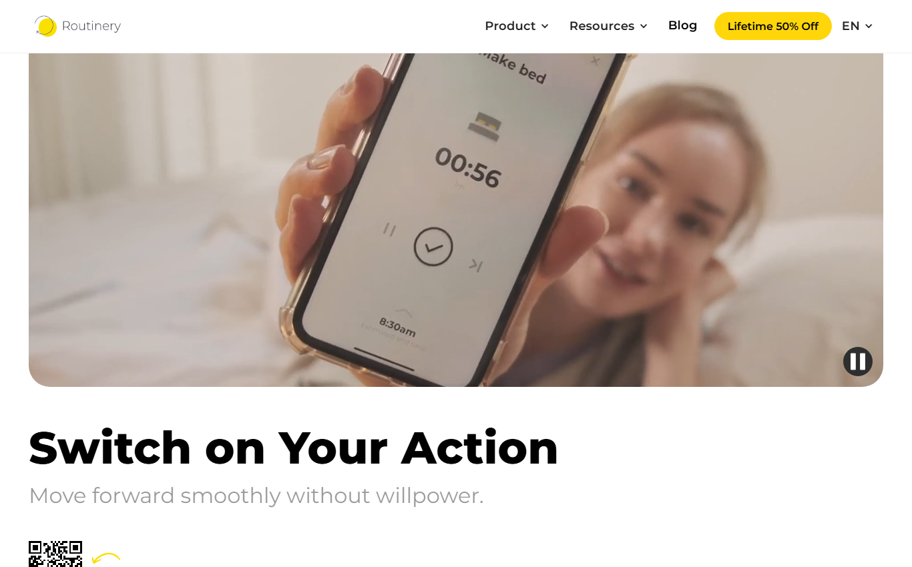

# Competitive Landscape: Focus Bear vs Other Productivity Apps  

**Milestone:** 1  
**Issue Number:** #55  
**Date:** 23/10/2026  

## The Apps I Compared

- I looked at the websites and app pages of each app, and I use Focus Bear myself on my laptop.
- The competitors fall into **two groups**:
  - **Blockers:** Freedom and Cold Turkey
  - **Planners / routine builders:** Tiimo and Routinery

### Focus Bear

- A "gentle focus coach for busy brains", **built by AuDHDers for AuDHDers** (people with ADHD and autism).
- Combines **routines**, **distraction blocking**, **focus sessions**, **micro-breaks**, **focus music** and planning tools in one app.

### Freedom (blocker)

- Blocks distracting websites and apps.
- Its main strength is **syncing blocks across all your devices** (laptop and phone) from one session.
- Has scheduled sessions and a "Locked Mode" so you can't end a session early.

### Cold Turkey (blocker)

- A **very strict desktop blocker** for Windows and Mac. Once a block starts, it's almost impossible to stop.
- The paid version is a **one-time purchase**, and there's a free version.
- There's no phone app or cross-device sync.

### Tiimo (planner)

- A **visual daily planner** for neurodivergent people.
- Your day is shown as colour-coded tasks with icons, a focus timer and reminders, plus an AI co-planner.
- Mainly iPhone, iPad, Mac and web.

### Routinery (routine builder)

- A **step-by-step routine timer**: it walks you through a routine (e.g. "make bed") one step at a time, with a countdown for each step.

## Quick Comparison

| Feature | Focus Bear | Freedom | Cold Turkey | Tiimo | Routinery |
|---|---|---|---|---|---|
| Guided routines / habits | ✅ | ❌ | ❌ | ✅ (visual plan) | ✅ (main feature) |
| Website / app blocking | ✅ | ✅ (main feature) | ✅ (strictest) | ❌ | ❌ |
| Blocking across devices | ✅ | ✅ | ❌ (per computer) | ❌ | ❌ |
| Focus sessions / timers | ✅ | ✅ (sessions) | ✅ (timed blocks) | ✅ | ✅ |
| Breaks with movement prompts | ✅ (micro-breaks) | ❌ | ✅ (basic break timer) | ❌ | ❌ |
| Focus music | ✅ | ❌ | ❌ | ❌ | ❌ |
| Visual day timeline | ❌ (has Day Plan) | ❌ | ❌ | ✅ (main feature) | ❌ |
| Built for ADHD / autism | ✅ | ❌ (general) | ❌ (general) | ✅ | Partly |

- Prices change often and sources disagree, so I didn't compare exact prices. Freedom, Focus Bear and Tiimo are subscriptions with free trials or free versions. Cold Turkey's paid version is a one-time payment.

## Reflection

### What makes Focus Bear different from these apps?

- **Focus Bear does both!**
  - Most of the other apps do **one of two things**: they either **block distractions** (Freedom, Cold Turkey) or help **build daily routines and habits** to keep the day scheduled (Tiimo, Routinery).
  - Focus Bear does **both** in one app, so I don't need two or three separate tools.
- It also adds things the others don't have together: **focus music**, **micro-breaks** with movement, a **brain dump**, and **focus sessions**.
- It's designed specifically for **ADHD and autism**, by people who have them.

### If I were a user, why would I choose Focus Bear over competitors?

- I'd choose it to have **everything in one place**: routines in the morning and evening, focus sessions with distractions blocked during the day, and proper breaks.
- From my own use:
  - **Blocking** distracting sites (like YouTube and gaming sites) helps me not get distracted while studying or working.
  - **Focus music** is very calming and helps me relax and focus.
  - **Focus sessions** and **micro-breaks** are easy to use and help me stay on track.
- **Honestly:**
  - If I **only** wanted the strictest website blocker, **Cold Turkey** would be more focused on that.
  - If I mainly wanted a **visual plan of my day on my phone**, **Tiimo** looks better for that.
  - Focus Bear is the better choice when you want **blocking and routines together**.

### What's one feature that other apps have that Focus Bear doesn't?

- **Tiimo's visual, colour-coded timeline of the day:**
  - You can *see* your whole day at a glance, with icons and a focus timer.
  - Focus Bear has a Day Plan, but not this kind of picture-based view, which helps people who struggle to "see" how much time they have.

### Based on my research, what's one improvement I think Focus Bear could make?

- **Keep features minimal and put related features together in one place**, instead of scattering them around.
  - Competitors like Freedom, Cold Turkey and Routinery feel simpler because they focus on one main job.
  - Focus Bear does more, so its layout needs to be extra clear.
  - In my first-time user testing (issue #56), blocking was split between the **Blocking** tab and **Settings → Strictness → Super Distracting Sites**, and I forgot where my blocked sites list was.
- Keeping related features together would help users **understand the app faster** and **remember where features are**, without getting confused.

## Sources

- [Focus Bear website](https://www.focusbear.io) and [pricing page](https://focusbear.io/pricing)
- [Freedom website](https://freedom.to/)
- [Cold Turkey website](https://getcoldturkey.com/) and [TechRadar: Cold Turkey review](https://www.techradar.com/reviews/cold-turkey)
- [Tiimo on the App Store](https://apps.apple.com/us/app/tiimo-visual-daily-planner/id1480220328)
- [Routinery website](https://routinery.app/)
- [TechCrunch: best distraction blockers](https://techcrunch.com/2025/12/25/the-best-distraction-blockers-to-jumpstart-your-focus-in-the-new-year)
- [Focus Bear vs Freedom (Focus Bear blog)](https://focusbear.io/blog-post/focus-bear-vs-freedom-whats-the-best-way-to-block-distractions-when-you-want-to-do-deep-work)
