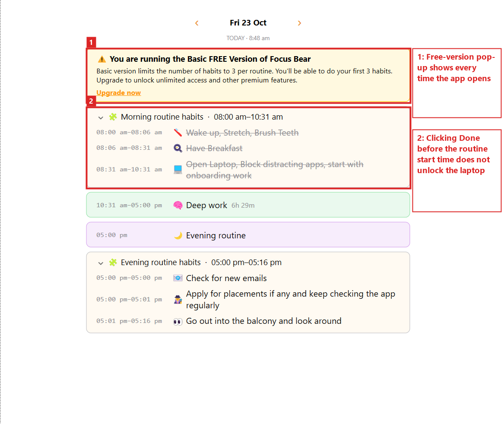
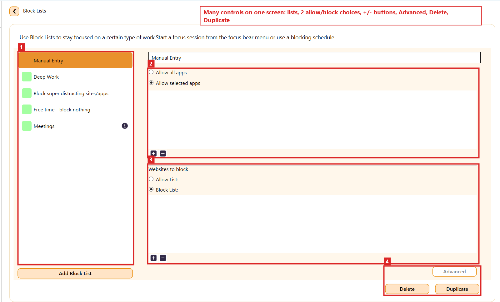
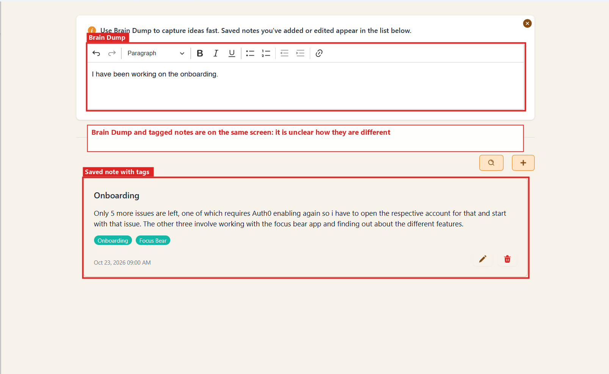
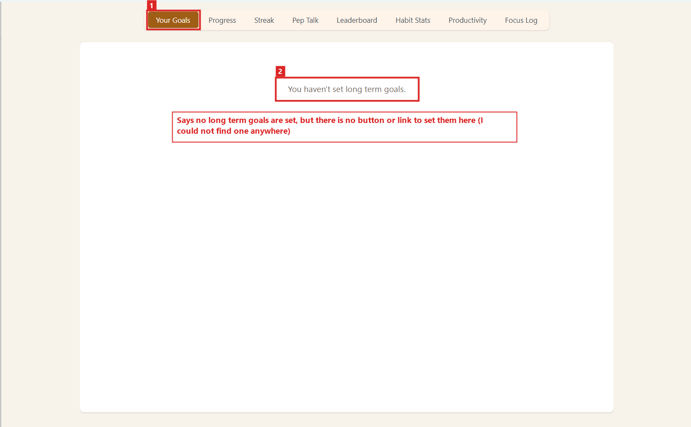
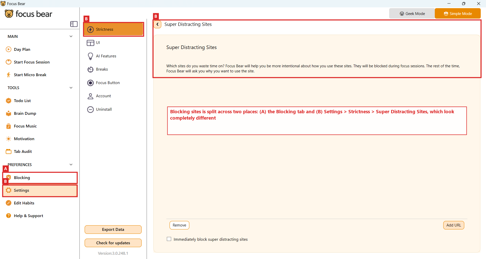

# Trying Out the Focus Bear App: First-Time User Experience  

**Milestone:** 1  
**Issue Number:** #56  
**Date:** 23/10/2026  

## What I Did

- Downloaded and installed the Focus Bear app on my Windows laptop (version 3.0.248.1) using the given instructions.
- Used it as a new user would: set up morning and evening routines, a deep work block, block lists, Brain Dump notes, focus sessions, micro-breaks and focus music.
- Took screenshots of everything that felt **confusing, frustrating or unclear** and marked the problem areas in red.
- Below are my **5 main points**, what I liked, and how I think onboarding could be improved.

## Point 1: Can't Complete a Routine Early

- **What happens:**
  - Every time I open Focus Bear on my laptop, the Day Plan with my routines pops up.
  - It asks me to either **postpone** the routine or mark it as **done**.
  - Sometimes I've already finished my morning routine (wake up, stretch, brush teeth, breakfast) **before** its scheduled time.
  - When I click **Done** before the routine's time frame starts, it **doesn't unlock the laptop**.
  - The same pop-up (with the **"You are running the Basic FREE Version"** banner) keeps showing.
- **Why it's frustrating:**
  - I have to **wait until the routine's start time** before pressing Done, just to complete it and unlock the app or laptop.
  - Real life doesn't always follow the schedule, so finishing a routine early should be allowed, not blocked.
- **Suggestion:**
  - Allow marking a routine as done early, or show a clear message explaining *why* Done isn't working yet.
  - Don't show the free-version banner every time the app opens.

## Point 2: Block Lists Screen Feels Overwhelming

- **What happens:**
  - When I want to block something, I end up on the **Block Lists** screen. It has a lot on one page:
    1. a list of block lists
    2. "Allow all apps / Allow selected apps" with **+ / −** buttons
    3. "Websites to block" with "Allow List / Block List" and **more + / −** buttons
    4. **Advanced**, **Delete** and **Duplicate** buttons
  - There's no step-by-step guidance on what to click first.
- **Why it's confusing:**
  - With so many buttons, it's hard to know **where to click to do what**.
  - This is especially hard for **children** or **elderly users** who aren't very familiar with technology.
  - They'd have to spend time learning the interface. Many people would rather deal with distractions on their own than feel overwhelmed, which could **lower user retention**.
- **Suggestion:**
  - A simple first view, e.g. "Add a website to block" with one text box.
  - Keep the advanced options (allow lists, apps, duplicate) behind the **Advanced** button.

## Point 3: Brain Dump vs Notes Is Unclear

- **What happens:**
  - The **Brain Dump** editor sits on top, and below it are **saved notes with tags** (e.g. "Onboarding", "Focus Bear").
  - They look like two separate features put together on one screen.
- **Why it's confusing:**
  - As I understand it, **Brain Dump** is for quickly dumping everything in your head (e.g. before a break) so you don't forget anything.
  - **Notes** do roughly the same thing, but with tags.
  - A new user may not understand the difference, or why they should make notes when Brain Dump already exists.
  - It's a small thing, but it makes the app feel less clear and lowers the overall experience.
- **Suggestion:**
  - Add a short line explaining the difference, e.g. "Brain Dump = quick thoughts, cleared later. Notes = saved and organised with tags".
  - Or put them in two clearly named sections.

## Point 4: "You Haven't Set Long Term Goals", But No Way to Set Them

- **What happens:**
  - On the **Your Goals** tab, the app says **"You haven't set long term goals."**
  - It doesn't say **where** or **how** to set them. There's no button or link on this page.
- **What I tried:**
  - I checked every item under **Main**, **Tools** and **Preferences**, opened them, and clicked through everything looking for a way to set or update goals.
  - **I couldn't find any button to set goals in the desktop app.**
- **Why it's frustrating:**
  - A user who sees this message probably **wants** to set goals right then, but has no way forward.
  - If the feature exists somewhere else (e.g. the mobile app), the page should say so.
- **Suggestion:**
  - Add a **"Set your goals"** button right on this page, so goals can be created and updated in the same place where they're shown.

## Point 5: Blocking Is Split Across Two Places

- **What happens:**
  - Websites can be blocked from two different places:
    - **(A)** the **Blocking** tab in the sidebar
    - **(B)** **Settings → Strictness → Super Distracting Sites**
  - The two screens look completely different, even though they both do the same job: blocking sites.
- **My experience:**
  - When I started using the app, I was browsing through Settings and found **Super Distracting Sites**.
  - I added a few URLs. It worked really well and helped me not get distracted.
  - A few days later I wanted to add more sites to the same list, but I **forgot where I had found it**.
  - I clicked the **Blocking** tab, but it looked completely different, so I wasn't sure where my list had gone, or whether these were two different features.
- **Suggestion:**
  - Put **Super Distracting Sites** inside the **Blocking** tab, or at least link to it from there, so everything about blocking is in one place.

## Overall Problem: Features Feel Scattered

- The main issue is **how the app is structured**:
  - related features are **spread across different places**
  - there are many different-looking buttons and screens
- For a first-time user, figuring it out feels **like a puzzle**, and it takes time to understand where everything is.
- The **basic, upfront features** are easy to figure out: focus sessions, micro-breaks, setting up routines and taking notes.
- It gets confusing when you try something more, like **blocking** (and I also found the **projects** feature confusing).

## What I Liked

- **Focus Music:** very calming and soothing. It helps relieve stress, both while working and even when I'm not working.
- **Focus sessions and micro-breaks:** easy to start and really helpful for staying focused and remembering to take breaks.
- **The "i" (information) icons** next to some features explain what they do, which helps new users understand the app. More of these would help.
- **Super Distracting Sites** blocking worked very well once I set it up.

## How the Onboarding Experience Could Be Improved

- **Group related features together:** all blocking in one place, Brain Dump and notes clearly separated, goals set where they're shown.
- **Guide new users step by step** the first time they open a complex screen like Block Lists (a short walkthrough or tooltips).
- **Simple mode first, advanced options hidden:** show the basic action first and keep extra options under "Advanced".
- **Never leave a dead end:** every empty state (like "You haven't set long term goals") should include a button to fix it.
- **Be flexible with routines:** let users mark a routine as done early, and explain clearly when something is locked and why.
- **Show the free-version message less often**, so it doesn't feel like it's blocking the user every time they open the app.
