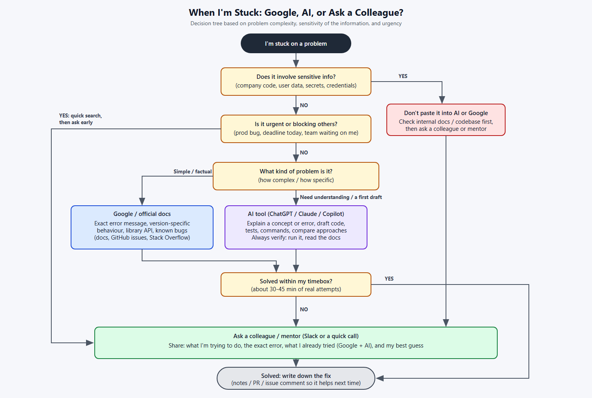

# When You Get Stuck: Google, AI Tools, or Ask for Help?  

**Milestone:** 10  
**Issue Number:** #75  
**Date:** 21/10/2026  

## What I Did

- Researched best practices for troubleshooting coding problems.
- Spent 30 minutes talking with ChatGPT about when AI is helpful in coding and when it isn't.
- Built a **decision tree** for choosing between Google, AI tools and asking a colleague, based on **complexity**, **sensitivity** and **urgency**.
- Exported the flowchart as a PNG and added it to this repo.

## Best Practices for Troubleshooting

- **Read the full error message** and stack trace first. The answer is often in the first few lines.
- **Reproduce the problem** reliably before trying to fix it.
- **Make it smaller:** cut the problem down to the smallest piece of code that still fails.
- **Change one thing at a time** and re-test, so I know what actually fixed it.
- **Check the basics:** wrong folder, server not running, Docker container stopped, wrong `.env` value, wrong package version.
- **Timebox:** give it a fixed amount of real effort (about 30–45 minutes) before asking for help.
- **Write down the fix** so I (or a teammate) don't lose time on the same problem again.

## What I Learned from ChatGPT About Using AI for Coding

- **AI is helpful for:**
  - explaining an error message or a concept in simple words
  - writing boilerplate, tests and terminal commands as a first draft
  - comparing approaches ("Passport vs a custom guard")
  - rubber-ducking: explaining the problem often makes the answer clear
- **AI is not helpful (or is risky) for:**
  - very new library versions, where it can give outdated APIs
  - company-specific code and business rules it has never seen
  - anything with secrets, customer data or private code, which must not be pasted in
  - "it looks right" answers that are actually wrong; it can sound confident even when it's wrong
- **Main takeaway:** treat AI output like a suggestion from a smart stranger. **Run it, test it and check the docs** before trusting it.

## Decision-Making Framework

- **1. Sensitivity first:** if the problem involves company code, user data or credentials, I don't paste it into AI or Google. I check internal docs or the codebase, then ask a colleague.
- **2. Urgency:** if it's blocking others or there's a deadline today, I do a quick search, then **ask early** instead of spending hours alone.
- **3. Complexity:**
  - **Simple or factual** (an exact error, how a library function works, a version issue) → **Google or official docs**
  - **Need understanding or a first draft** (a concept, test setup, a command) → **AI tool**, then verify
- **4. Timebox:** if it's not solved after about 30–45 minutes of real attempts → **ask a colleague**, sharing what I tried.
- **5. Done:** write down the fix.

## Reflection

### When do you prefer using AI vs. searching Google?

- **I use AI** when I need something **explained** or a **starting point**: what an error means, how mocking works in NestJS, or the commands to set something up. It answers my exact question and lets me ask follow-ups. It helps get the detailed explanation about a specific topic and sometimes help me with coding in more detail.
- **I use Google or the official docs** when I need something **exact and current**: a specific error message, version-specific behaviour, or the correct API. In this milestone, NestJS 12 being ESM-only and Jest needing `--experimental-vm-modules` was the kind of version detail I checked against real docs and real output. 
- I often use both: AI to understand, then docs to confirm.

### How do you decide when to ask a colleague instead?

- When the problem involves **company-specific code or data** that only the team knows, or that I shouldn't paste into AI.
- When it's **urgent** or I'm blocking someone else.
- When it's a decision, not a bug, e.g. "which approach does the team prefer?"
- Before asking, I write down what I'm trying to do, the exact error, what I already tried, and my best guess. That makes it quick for them to help.

### What challenges do developers face when troubleshooting alone?

- **Tunnel vision:** trying the same idea over and over without stepping back.
- **Not knowing what you don't know:** missing context about how the system or the team works.
- **Time sink:** losing hours on something a teammate could explain in 5 minutes.
- **Hesitating to ask:** worrying about looking inexperienced, especially as an intern working **remotely**, where there's no one sitting next to you.
- **Trusting AI too much:** an answer can look right but not match my versions or setup, so I always have to verify it by running it.
