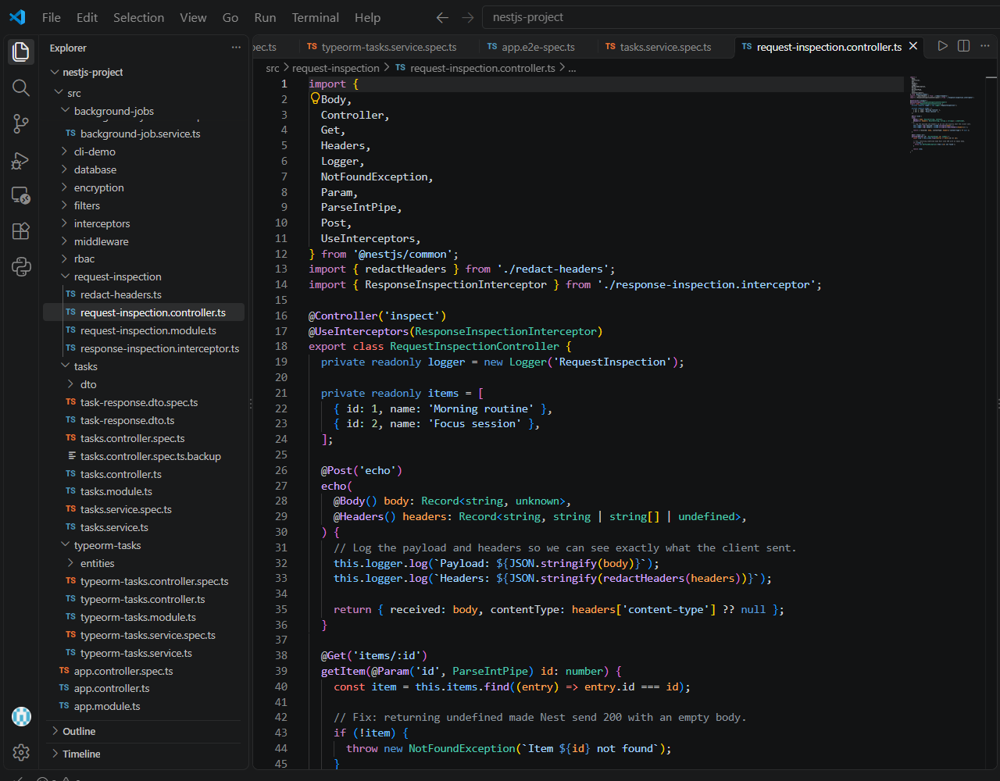
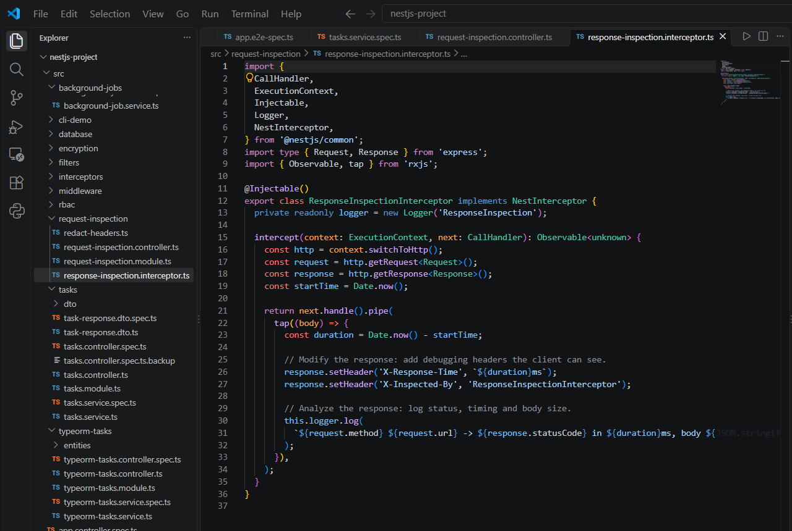
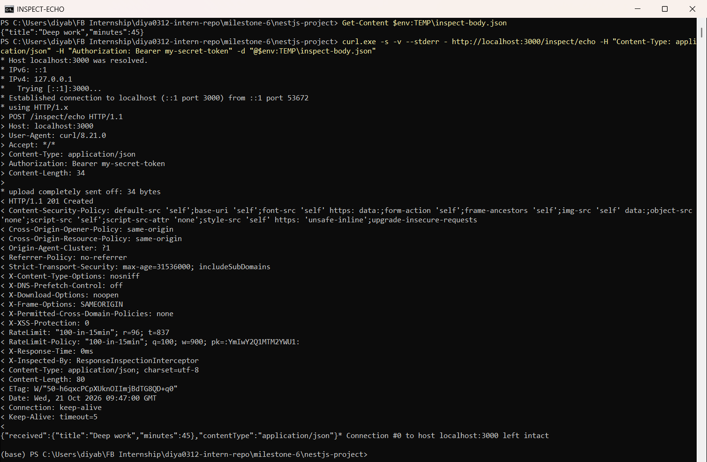
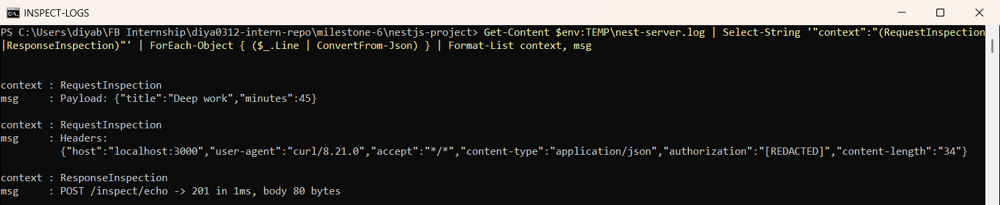
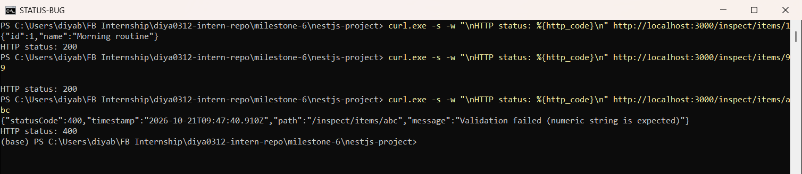
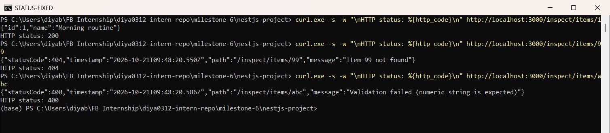

# Inspecting API Requests & Responses  

**Milestone:** 10  
**Issue Number:** #17  
**Date:** 21/10/2026  

## What I Did

- Added a `request-inspection` module to my NestJS project (`milestone-6/nestjs-project`).
- Logged request **payloads and headers** in a controller, with sensitive headers redacted.
- Built an **interceptor** that adds debug headers to every response and logs the status code, time and body size.
- Used `curl -v` to inspect the full request and response.
- Found and fixed a real **wrong status code** bug (`200` instead of `404`).
- Added unit tests for all of it (7 tests, all passing).

## Tools for Inspecting API Requests

- **curl**
  - Command-line tool, already on Windows as `curl.exe`.
  - `-v` shows **everything**: request line, request headers, response status, response headers and body.
  - `-w "%{http_code}"` prints just the status code, which is handy for quick checks.
  - Commands are easy to copy, share and repeat.
- **Bruno**
  - Open-source desktop API client.
  - Requests are saved as plain `.bru` files, so collections can live in Git with the code.
- **Postman**
  - Popular API client with a GUI, environments and test scripts.
  - Collections are mostly stored in the Postman cloud.
- I used **curl** for this issue because `-v` shows the raw request and response exactly as they go over the wire.

## Logging Request Payloads and Headers in a Controller

- `POST /inspect/echo` uses `@Body()` and `@Headers()` to read the request.
- It logs:
  - `Payload: {...}`: the exact JSON the client sent
  - `Headers: {...}`: all headers, passed through `redactHeaders()` first
- `redactHeaders()` replaces `authorization`, `cookie` and `x-api-key` with `[REDACTED]`, so secrets never end up in log files.

## Using an Interceptor to Modify and Analyze Responses

- `ResponseInspectionInterceptor` is applied to the controller with `@UseInterceptors()`.
- **Modifies** the response by adding two headers:
  - `X-Response-Time`: how long the handler took
  - `X-Inspected-By: ResponseInspectionInterceptor`
- **Analyzes** the response by logging the method, URL, **status code**, duration and body size.

## Inspecting a Request with `curl -v`

- I sent a JSON body (`{"title":"Deep work","minutes":45}`) with a fake `Authorization` token.
- **Lines starting with `>`** are the request: method + path, `Content-Type: application/json`, `Authorization`, and `Content-Length: 34`.
- **Lines starting with `<`** are the response:
  - Status `HTTP/1.1 201 Created`
  - Helmet's security headers
  - My interceptor's `X-Response-Time` and `X-Inspected-By` headers, which proves the interceptor changed the response
  - The body echoing the payload back

## Server-Side Logs

- I saved the server output to a log file and filtered it to my two loggers.
- `RequestInspection` logged the exact payload and the headers. The token shows as **`"authorization":"[REDACTED]"`**.
- `ResponseInspection` logged `POST /inspect/echo -> 201 in 1ms, body 80 bytes`.

## Debugging a Wrong Status Code

- **Problem:** I checked status codes with `curl -w "%{http_code}"`.
  - `GET /inspect/items/1` → `200` with the item ✅
  - `GET /inspect/items/abc` → `400` from `ParseIntPipe` ✅
  - `GET /inspect/items/99` → **`200` with an empty body** ❌. A missing item should be `404`.

- **How I found the cause:**
  - The interceptor log showed `GET /inspect/items/99 -> 200 in 0ms, body 4 bytes`. The 4 bytes are `null`, which means the handler returned nothing.
  - In the controller, `items.find()` returned `undefined`. NestJS sends `200` with an empty body when a handler returns `undefined`.
- **Fix:** if the item isn't found, throw `NotFoundException('Item 99 not found')`.
- **After the fix:** `GET /inspect/items/99` → **`404`** with `{"statusCode":404, ..., "message":"Item 99 not found"}`.

- **Unit tests** in `request-inspection.spec.ts` (7 passing) cover:
  - header redaction
  - payload logging, including that the token is never logged
  - the `404` fix
  - the interceptor's headers and log

## Reflection

### How can logging request payloads help with debugging?

- It shows **exactly** what the client sent, not what we think it sent.
- It catches problems like a wrong field name, a number sent as a string, missing fields, or a broken JSON body. Before using the temp file, my first curl attempt sent broken JSON and got a `400`.
- Logging headers shows missing `Content-Type` or `Authorization` headers, which often explain `400` or `401` errors.

### What tools can you use to inspect API requests and responses?

- **curl** (`-v`, `-i`, `-w "%{http_code}"`) for quick, repeatable checks from the terminal.
- **Bruno** and **Postman** for saved collections, environments and auth tokens in a GUI.
- **NestJS middleware, interceptors and loggers** to see the request from the server side.
- **Browser DevTools (Network tab)** when the request comes from a web app.

### How would you debug an issue where an API returns the wrong status code?

1. Reproduce it with `curl -v` or `curl -w "%{http_code}"` and write down the actual vs. expected status.
2. Check the server logs or interceptor output for that request, including status, body size and errors.
3. Follow the request path: route → pipes (validation) → guards → controller → service → exception filter.
4. Look for common causes:
   - returning `undefined` instead of throwing (my bug)
   - catching an error and returning normally
   - a missing `@HttpCode()`
   - the exception filter mapping the error to the wrong status
5. Fix it, then add a test that checks the status code so it can't come back.

### What are some security concerns when logging request data?

- Logs can leak **secrets**: `Authorization` tokens, cookies, API keys and passwords in request bodies.
- Logs can leak **personal data**: emails, names, health or usage data. This matters for privacy laws.
- Log files are often kept for a long time and seen by more people than the database, so they need the same care.
- **What I did:** `redactHeaders()` hides `authorization`, `cookie` and `x-api-key`, and pino's `redact` setting in `app.module.ts` also hides `authorization` and `cookie` in HTTP logs.
- Good practice: log only what's needed, redact sensitive fields, and use lower log levels for full payloads in production.
