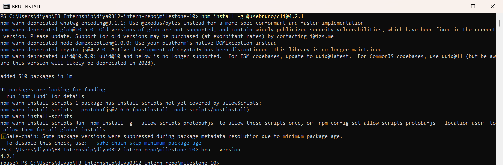
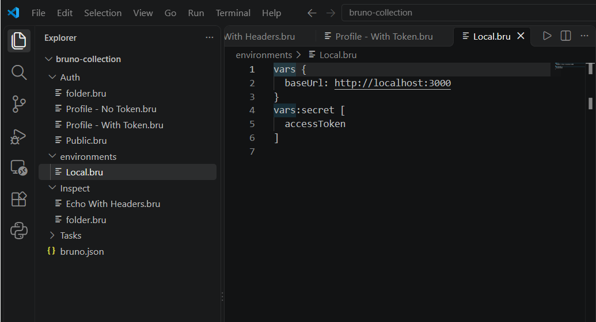
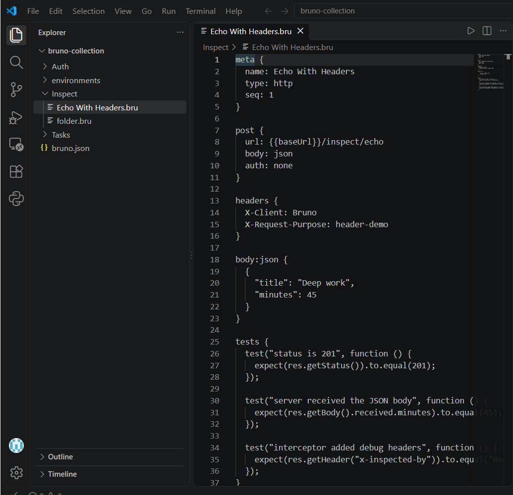
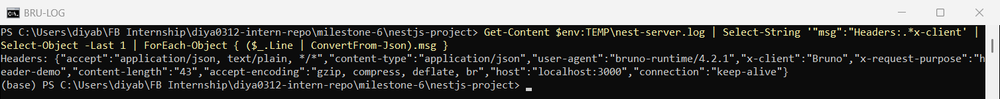
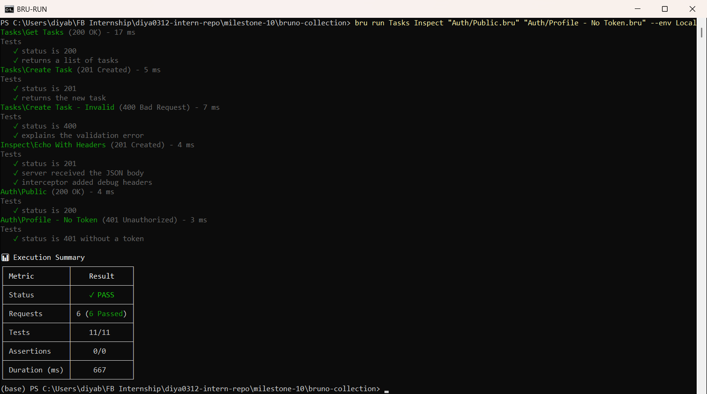
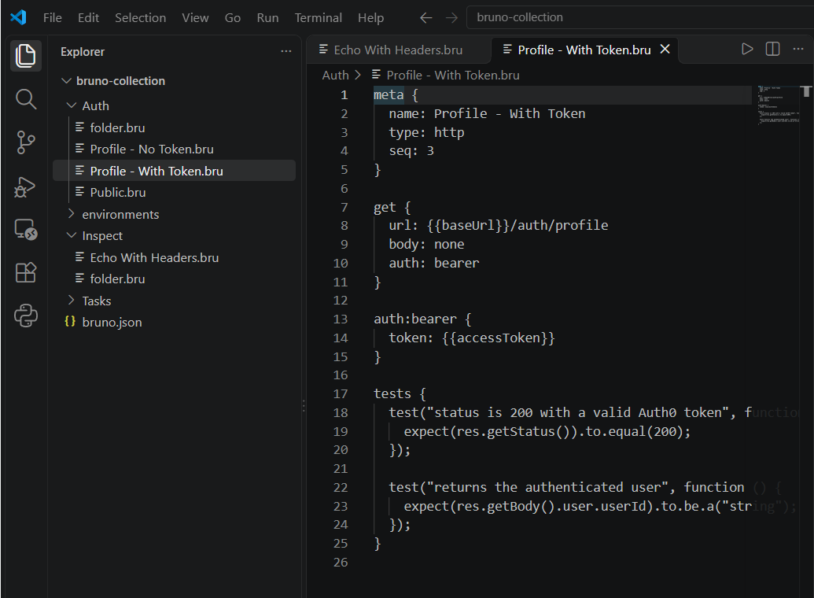
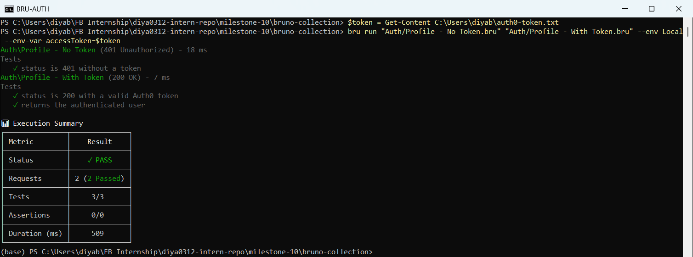

# API Debugging with Bruno  

**Milestone:** 10  
**Issue Number:** #28  
**Date:** 21/10/2026  

## What I Did

- Installed the Bruno CLI (`@usebruno/cli`).
- Created a Bruno collection, **Focus Bear NestJS API**, in `milestone-10/bruno-collection`.
- Added requests for my NestJS endpoints (tasks, request inspection, auth), each with **tests**.
- Used a **Local environment** (`baseUrl`) and a **secret variable** (`accessToken`) for the Bearer token.
- Sent custom headers and an authenticated request.
- Ran the collection against my running NestJS app: **all requests and tests passed.**

## What Is Bruno and How Is It Different from Postman?

- **Bruno** is an open-source API client for testing REST (and GraphQL) APIs, like Postman.
- **Main difference: where collections live.**
  - Bruno saves each request as a plain-text `.bru` file **on my computer**, so the collection can sit in the Git repo next to the code.
  - Postman stores collections in its **cloud account** by default, and syncing or sharing is tied to the Postman workspace.
- Bruno works **offline** with no account needed.
- `.bru` files are easy to read and review in a pull request, like code.
- Bruno has a desktop app **and** a CLI (`bru run`), so the same collection can run in a terminal or in CI.

## Creating the Collection

- `bruno.json` marks the folder as a Bruno collection.
- **Folders** group requests by feature:
  - `Tasks/`: Get Tasks, Create Task, Create Task - Invalid
  - `Inspect/`: Echo With Headers
  - `Auth/`: Public, Profile - No Token, Profile - With Token
- `environments/Local.bru`:
  - `baseUrl: http://localhost:3000`, so every request uses `{{baseUrl}}` instead of a hard-coded URL
  - `accessToken` under `vars:secret`, so the token value is **not saved in the file** or in Git

## Adding a Request with Headers

- `Echo With Headers` sends a JSON body to `POST /inspect/echo` (the endpoint from issue #17).
- The `headers { }` block adds custom headers: `X-Client: Bruno` and `X-Request-Purpose: header-demo`.
- The `tests { }` block checks:
  - the status is `201`
  - the server got the body
  - my interceptor's `X-Inspected-By` response header is there

- The NestJS server log shows the headers really arrived from Bruno: `"user-agent":"bruno-runtime/4.2.1"`, `"x-client":"Bruno"`, `"x-request-purpose":"header-demo"`.

## Running the Collection

- Command: `bru run Tasks Inspect "Auth/Public.bru" "Auth/Profile - No Token.bru" --env Local`
- **Result: 6 requests passed, 11/11 tests passed.**
  - `GET /tasks` → `200`, returns a list
  - `POST /tasks` → `201`, returns the new task
  - `POST /tasks` with an empty title → `400`, with the validation message
  - `POST /inspect/echo` → `201`, with the interceptor header present
  - `GET /auth/public` → `200`
  - `GET /auth/profile` without a token → `401`

## Sending an Authenticated Request

- `Profile - With Token` uses Bruno's **Bearer auth**: `auth: bearer` with `token: {{accessToken}}`.
- Bruno adds the `Authorization: Bearer <token>` header for me.
- The real token comes from Auth0 (see issue #31). I passed it in when running, so it's never saved in the collection:
  - `bru run "Auth/Profile - With Token.bru" --env Local --env-var accessToken=<token>`
- **Result:** `200`, and the response contained the authenticated user.

## Reflection

### How does Bruno help with API testing compared to Postman or cURL?

- **vs cURL:** requests are **saved and organised**, with variables, auth and tests. I don't have to retype long curl commands or fight PowerShell's JSON quoting, which I ran into in issue #17.
- **vs Postman:** collections are plain files **in my Git repo**, so they're versioned and reviewed with the code, work offline, and need no account.
- Built-in `tests { }` turn each request into a quick API check, and `bru run` runs them all at once.

### How do you send an authenticated request in Bruno?

- Set the request's auth type to **Bearer** (`auth: bearer`) and the token to a variable: `token: {{accessToken}}`.
- Keep `accessToken` as a **secret environment variable**, so it isn't written to the `.bru` files or pushed to Git.
- Supply the token at run time: in the app's environment settings, or with `--env-var accessToken=...` in the CLI.
- Other options: an `Authorization` header in the `headers { }` block, API key auth, or Bruno's OAuth2 settings.

### What are the advantages of organizing API requests in collections?

- Everything for one API is in one place, grouped into folders by feature.
- Environments (`Local`, `Staging`) let the same requests run against different servers by changing one variable.
- The whole collection can run in one go as a quick regression check.
- New team members can clone the repo and start calling the API straight away.
- Changes to requests show up in Git history and pull requests.

### How would you structure a Bruno collection for a NestJS backend project?

- **One folder per NestJS module or controller**, e.g. `Auth`, `Tasks`, `Users`, `Background Jobs`, to match the code structure.
- In each folder:
  - a request for the **happy path**
  - requests for the main **error cases** (`400` validation, `401`, `403`, `404`)
- **Environments** for `Local`, `Staging` and `Production`, with `baseUrl` and **secret** tokens.
- **Collection- or folder-level auth**, so protected folders share the same Bearer token.
- **Tests on every request** (status + key fields), so `bru run` can be used in CI.
- Keep the collection in the backend repo, next to the code it tests.
