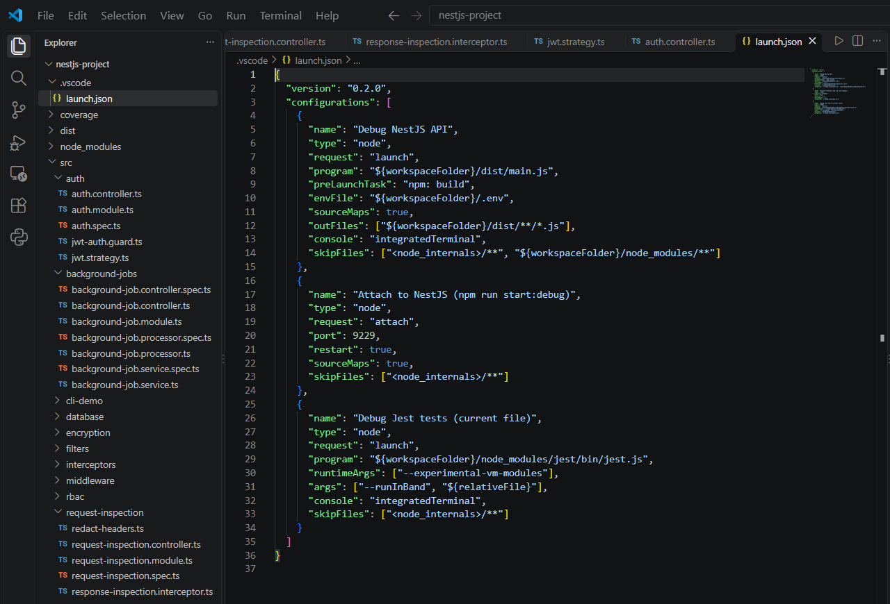

# Debugging with VS Code & Breakpoints  

**Milestone:** 10  
**Issue Number:** #18  
**Date:** 21/10/2026  

## What I Did

- Created a VS Code debug configuration (`.vscode/launch.json`) for my NestJS project (`milestone-6/nestjs-project`).
- Put breakpoints in `TasksController.createTask()` and `TasksService.createTask()`.
- Sent a `POST /tasks` request and **stepped through** the code from the controller into the service.
- Watched the variable values change in the **Variables** panel.

## How VS Code Debugging Works for NestJS

- NestJS is TypeScript, but Node runs the compiled JavaScript in `dist/`.
- `sourceMap: true` in `tsconfig.json` creates `.js.map` files, so VS Code can map the running JavaScript back to my **TypeScript lines**. That's why breakpoints in `.ts` files work.
- VS Code's Node debugger connects to Node's built-in inspector, which pauses the code at breakpoints.

## The `launch.json` Configuration

- **`Debug NestJS API`** (the one I used):
  - `preLaunchTask: "npm: build"` builds the project first.
  - `program: dist/main.js` starts the compiled app.
  - `envFile: .env` loads the same environment variables as normal runs.
  - `sourceMaps` + `outFiles` connect `dist/*.js` back to `src/*.ts`.
  - `skipFiles` skips Node internals and `node_modules` when stepping, so I only step through my own code.
- **`Attach to NestJS`**: attaches to an app already running with `npm run start:debug` (inspector on port `9229`). Handy with `--watch`.
- **`Debug Jest tests`**: runs the current test file in the debugger, with `--experimental-vm-modules` because my project uses ESM.

## Breakpoint in the Controller

- Breakpoint on `tasks.controller.ts` line 30: `return this.tasksService.createTask(createTaskDto.title);`
- Started **Debug NestJS API** with `F5`, then sent:
  - `Invoke-RestMethod -Method Post http://localhost:3000/tasks -ContentType 'application/json' -Body '{"title":"Debug me"}'`
- VS Code **paused** on line 30. The request waited until I continued.
- The **Variables** panel showed `createTaskDto` = `{ title: 'Debug me' }`. This confirms the body passed the `ValidationPipe` and was turned into the DTO.
- The **Call Stack** showed the request going through NestJS's router into my controller.

## Stepping into the Service

- **Step Into (`F11`)** took me into `TasksService.createTask()`.
- **Step Over (`F10`)** went line by line:
  - `title` = `'Debug me'`
  - before `push`, `this.tasks` had **2** tasks
  - after `const task = {...}`, `task` = `{ id: 3, title: 'Debug me' }`
- **Continue (`F5`)** let the request finish, and the client got the new task back.

## Debug Controls I Used

- **Continue (`F5`):** run until the next breakpoint
- **Step Over (`F10`):** run the current line without going into function calls
- **Step Into (`F11`):** go inside the function being called
- **Step Out (`Shift+F11`):** finish the current function and go back to the caller
- **Variables / Watch / hover:** see values at the paused moment
- **Debug Console:** run expressions like `this.tasks.length` while paused

## Reflection

### How do breakpoints help in debugging compared to console logs?

- **No code changes:** no need to add `console.log`, rebuild and remember to remove it later.
- I can see **every** variable at that moment, not just the ones I thought to log.
- I can **step line by line** and watch values change, which shows exactly where something goes wrong.
- I can inspect values I didn't expect to need, like `this.tasks` or the call stack.
- Logs are still useful for production and for things that happen too fast or too often to pause, but breakpoints are faster for finding a bug locally.

### What is the purpose of `launch.json`, and how does it configure debugging?

- It tells VS Code **how to start or attach to** the program for debugging.
- Main settings:
  - `type` / `request`: Node, and whether to launch or attach
  - `program`: which file to run
  - `preLaunchTask`: build first
  - `envFile`: environment variables
  - `sourceMaps` / `outFiles`: map JS back to TS
  - `skipFiles`: don't step into library code
- It lives in `.vscode/` in the repo, so the whole team gets the same debug setup.

### How can you inspect request parameters and responses while debugging?

- Put a breakpoint in the controller method. The Variables panel shows `@Body()`, `@Param()` and `@Query()` values, e.g. `createTaskDto`.
- To see the raw request, add `@Req() req` temporarily, or break in middleware or an interceptor and look at `req.headers` / `req.body`.
- For the response, break on the `return` line or step out to see the returned value. An interceptor's `tap()` is also a good place to inspect the final response.
- The Debug Console lets me evaluate expressions like `createTaskDto.title.length` while paused.

### How can you debug background jobs that don't run in a typical request-response cycle?

- Put the breakpoint **in the worker**, e.g. `BackgroundJobProcessor.process()` from my BullMQ issue (#24), not in the controller.
- Start the app in the debugger and add a job (`POST /background-jobs`). The debugger pauses when the worker picks the job up, and I can see `job.id`, `job.data` and `job.attemptsMade`.
- If the worker runs as a separate process, use the **Attach** config with `--inspect` on that process.
- Use conditional breakpoints (e.g. `job.name === 'failing-job'`) to stop only on the job I care about.
- Check Redis for the job's state (`atm`, `failedReason`), like I did in issue #24, and use logs for retries that happen later.
