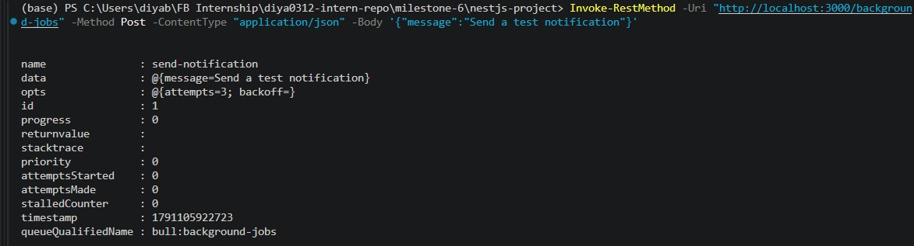
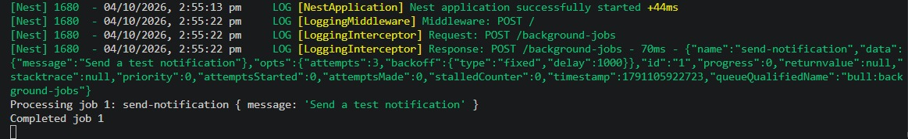
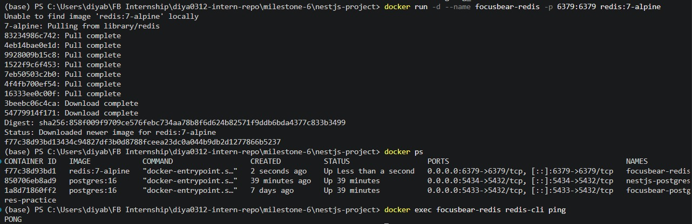
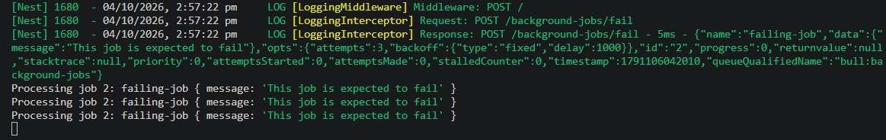

# NestJS BullMQ & Redis  

**Milestone:** 7      
**Issue Number:** #24      
**Date:** 04/10/2026  

## BullMQ

- BullMQ is a job queue system built on Redis.
- It allows time-consuming work to run outside the main API request.
- This helps keep API requests responsive.
- Jobs can be processed by separate workers.

## Queue Flow

```text
API request
    ↓
BullMQ Queue
    ↓
Redis
    ↓
BullMQ Worker
    ↓
Background task
```

## NestJS Setup

- Installed `@nestjs/bullmq` and `bullmq`.
- Configured the Redis connection using `BullModule.forRoot()`.
- Registered the `background-jobs` queue using `BullModule.registerQueue()`.
- Created a processor using `WorkerHost`.
- Injected the queue into a service using `@InjectQueue()`.

## Adding Jobs

- Added a `POST /background-jobs` endpoint.
- The endpoint places a `send-notification` job into the queue.
- The API receives a job ID without waiting for the background work to finish.



## Processing Jobs

- The `BackgroundJobProcessor` processes jobs from the queue.
- The processor simulates background work using an asynchronous delay.
- Successful jobs are moved to the completed state.



## Redis

- Redis acts as the backend for the BullMQ queue.
- Job information is persisted in Redis.
- This allows queued jobs to remain available when the application is restarted.
- Multiple producers and consumers can work with the same named queue.



## Failed Jobs and Retries

- If a processor throws an error, BullMQ marks the job as failed.
- Failed jobs can be automatically retried using the `attempts` option.
- Backoff settings can control the delay between retry attempts.
- The example job was configured with three attempts.



## Why Background Jobs?

- Long-running work can slow down API requests if handled directly.
- Background jobs allow the API to return quickly while processing continues separately.
- They are useful for:
  - Sending notifications
  - Processing analytics
  - Synchronizing data
  - Generating reports
  - Other time-consuming operations

## Reflection

- **Why is BullMQ used instead of handling tasks directly in API requests?**
  - BullMQ runs time-consuming tasks in the background, allowing the API to respond quickly without waiting for the task to finish.

- **How does Redis help manage job queues in BullMQ?**
  - Redis stores job information and helps BullMQ queues and workers communicate. It also helps retain queued job data across application restarts, depending on Redis persistence settings.

- **What happens if a job fails? How can failed jobs be retried?**
  - BullMQ marks the job as failed and can retry it using the `attempts` option. Backoff settings can add a delay between retries.

- **How would Focus Bear use BullMQ for background tasks?**
  - Focus Bear could use BullMQ for tasks such as sending notifications, processing analytics, generating reports, and syncing data without blocking the API.

- **Personal observations:**
  - During testing, I observed that the API returned a job ID before the background task finished processing.
  - I also learned how retries help handle temporary failures and why retry limits are useful.
