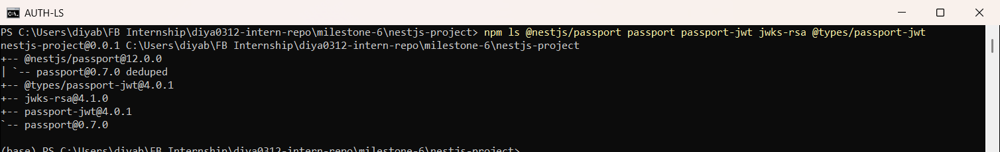
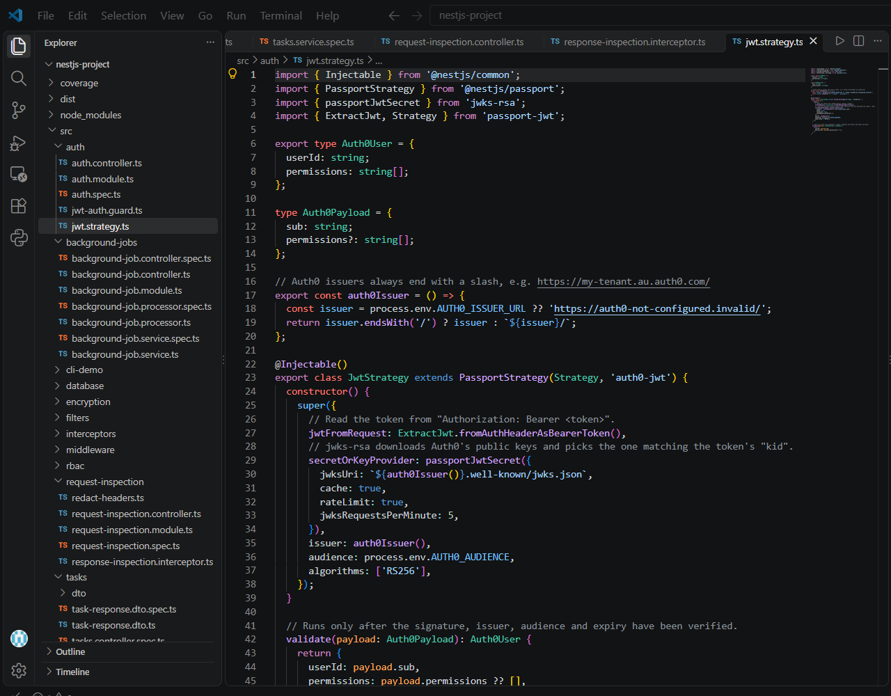
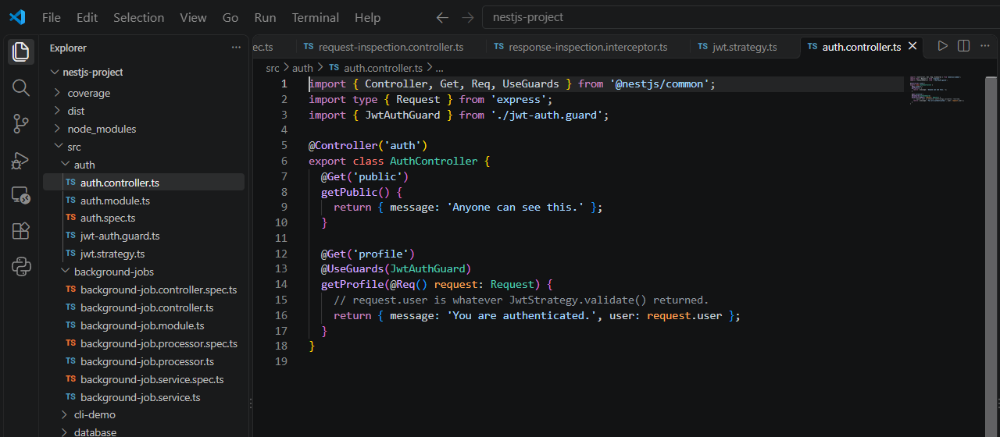
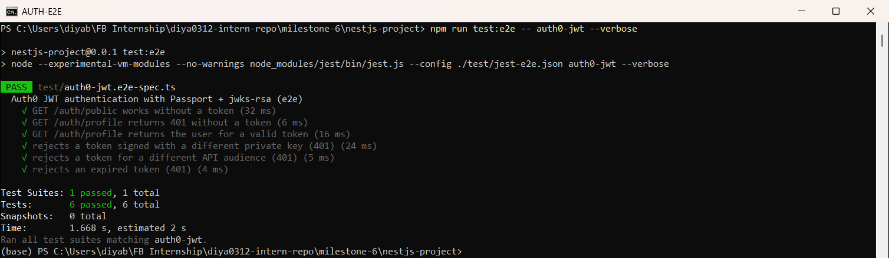
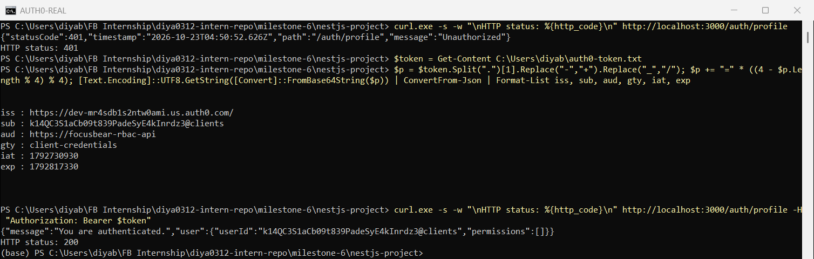

# Authentication in NestJS with Auth0 & JWT  

**Milestone:** 8  
**Issue Number:** #31  
**Date:** 21/10/2026  

## What I Did

- Researched how Auth0, JWTs and `jwks-rsa` work together in NestJS.
- Installed `@nestjs/passport`, `passport`, `passport-jwt` and `jwks-rsa`.
- Built a **Passport JWT strategy** that verifies Auth0 access tokens using Auth0's public keys (JWKS).
- Protected `GET /auth/profile` with a `JwtAuthGuard`. `GET /auth/public` stays open.
- Tested it with 6 e2e tests using test JWTs, and with a **real Auth0 access token** from my Auth0 tenant (the same tenant and API from issue #30, RBAC).

## How Auth0 Integrates with NestJS

- **Auth0** handles login (username/password, Google, etc.) and **issues access tokens** (JWTs) for my API.
- **NestJS doesn't handle passwords at all.** It only checks that the token Auth0 gave the client is valid.
- The packages:
  - `passport-jwt`: reads the token from the `Authorization: Bearer` header and verifies it
  - `jwks-rsa`: downloads Auth0's **public keys** from `https://<tenant>/.well-known/jwks.json` and picks the right one using the token's `kid`
  - `@nestjs/passport`: connects Passport strategies to NestJS guards (`AuthGuard('auth0-jwt')`)
  - `@nestjs/jwt`: used when **my own app signs** tokens with a secret. With Auth0, Auth0 signs the tokens, so I didn't need it here.

## How JWT-Based Authentication Works

- A JWT has 3 parts: `header.payload.signature`.
  - **Header:** algorithm (`RS256`) and key id (`kid`)
  - **Payload (claims):** `sub` (user id), `iss` (issuer = Auth0 tenant), `aud` (audience = my API), `exp` (expiry), `permissions`
  - **Signature:** made with Auth0's **private key**
- The API checks the signature with Auth0's **public key**. If anyone changes the payload, the signature no longer matches.
- The API is **stateless**: it doesn't store sessions, it just verifies the token on every request.

## How Auth0 Manages Sessions and Access Tokens

- Auth0 keeps the **login session** on its side (the Auth0 session cookie), so users don't have to log in again every time.
- The app receives a short-lived **access token** for calling the API, and an **ID token** with profile info for the frontend.
- When the access token expires, the app gets a new one using a **refresh token** or silent authentication, without asking the user to log in again.
- Each token is issued for a specific **audience** (API). A token for another API is rejected (tested below).

## The JWT Strategy

- `jwtFromRequest`: takes the token from the Bearer header.
- `secretOrKeyProvider: passportJwtSecret(...)`: `jwks-rsa` fetches and caches Auth0's public keys (`cache: true`, `rateLimit: true`).
- `issuer`, `audience` and `algorithms: ['RS256']` must all match, or the token is rejected.
- `validate()` only runs **after** the token is verified. It returns `{ userId, permissions }`, which becomes `request.user`.

## Protecting a Route

- `JwtAuthGuard` extends `AuthGuard('auth0-jwt')`.
- `@UseGuards(JwtAuthGuard)` on `GET /auth/profile` means only requests with a valid token reach the handler.
- `GET /auth/public` has no guard, so anyone can call it.

## Testing with Test JWTs (e2e)

- In `test/auth0-jwt.e2e-spec.ts` I started a small local server that acts like Auth0's JWKS endpoint, then signed test tokens with the matching private key.
- The **real** strategy and `jwks-rsa` code run in these tests. Only Auth0 itself is replaced.
- **Results: 6 tests passed:**
  - `/auth/public` without a token → `200`
  - `/auth/profile` without a token → `401`
  - valid token → `200` with `{ userId: 'auth0|test-user-123', permissions: ['read:tasks'] }`
  - token signed with a **different private key** → `401`
  - token for a **different audience** → `401`
  - **expired** token → `401`

## Testing with My Real Auth0 Tenant

- **Getting a real token:**
  - My existing Auth0 application is a public (login) app, so Auth0 doesn't allow the `client_credentials` grant for it ("Grant type 'client_credentials' not allowed").
  - I created a separate **Machine to Machine** application, **NestJS JWT Test**, and authorized it for **Focus Bear NestJS RBAC API**.
  - I got an access token for it from **APIs → Focus Bear NestJS RBAC API → Test**.
  - I saved the token in a file outside the repo, so it never appears in the code, the commits or the screenshots.
- **Running the app against Auth0:** I set `AUTH0_ISSUER_URL=https://dev-mr4sdb1s2ntw0ami.us.auth0.com/` and `AUTH0_AUDIENCE=https://focusbear-rbac-api`, then started the app.
- **Results:**
  - `GET /auth/profile` **without** a token → `401 Unauthorized`.
  - **Decoding the token's payload** (the middle part of the JWT) shows the claims Auth0 put inside it:
    - `iss`: my Auth0 tenant
    - `sub`: `k14QC3...@clients`, the M2M app's client id
    - `aud`: `https://focusbear-rbac-api`
    - `gty`: `client-credentials`
    - `iat` / `exp`: issued at / expires (24 hours later)
  - `GET /auth/profile` **with** the real Auth0 token → `200`, with `{"message":"You are authenticated.","user":{"userId":"k14QC3...@clients","permissions":[]}}`.
- This proves the full flow with **real Auth0**: Auth0 signed the token with its private key, `jwks-rsa` downloaded Auth0's public key from my tenant's `/.well-known/jwks.json`, and `passport-jwt` verified the signature, issuer, audience and expiry before letting the request through.

## Reflection

### How does Auth0 handle authentication compared to traditional username/password auth?

- **Traditional:** my API stores password hashes, checks logins, manages sessions, password resets and brute-force protection itself. That's a lot to get right.
- **Auth0:** Auth0 does all of that and gives my API a signed token. My API never sees passwords.
- I also get features like MFA, social login and account lockout without building them.
- **Trade-off:** I depend on an external service and have to configure it correctly (issuer, audience, rules/actions).

### What is the role of JWT in API authentication?

- The JWT is the **proof of identity** sent with every request in `Authorization: Bearer <token>`.
- It carries who the user is (`sub`), who issued it (`iss`), which API it's for (`aud`), when it expires (`exp`), and permissions or roles.
- Because it's signed, the API can trust it **without calling Auth0 or a database** on each request.

### How do `jwks-rsa` and public/private key verification work in Auth0?

- Auth0 signs tokens with its **private key** (RS256), which only Auth0 has.
- Auth0 publishes the matching **public keys** at `/.well-known/jwks.json`.
- `jwks-rsa` reads the token header's `kid`, downloads and caches the matching public key, and gives it to `passport-jwt` to check the signature.
- My test showed this working: a token signed with a different private key was rejected with `401`, even though everything else in it was correct.
- Auth0 can rotate keys, and `jwks-rsa` picks up new keys automatically by `kid`.

### How would you protect an API route so that only authenticated users can access it?

1. Create a Passport JWT strategy with `jwks-rsa`, the Auth0 issuer, the audience and `RS256`.
2. Create a guard: `class JwtAuthGuard extends AuthGuard('auth0-jwt') {}`.
3. Put `@UseGuards(JwtAuthGuard)` on the controller or route.
4. Use `request.user` in the handler to know who is calling.
5. For roles or permissions, add a second guard on top (like my `Auth0RolesGuard` from issue #30, which returns `403` when the role is missing).
