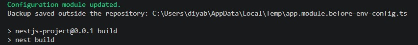
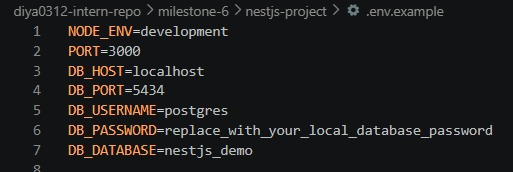
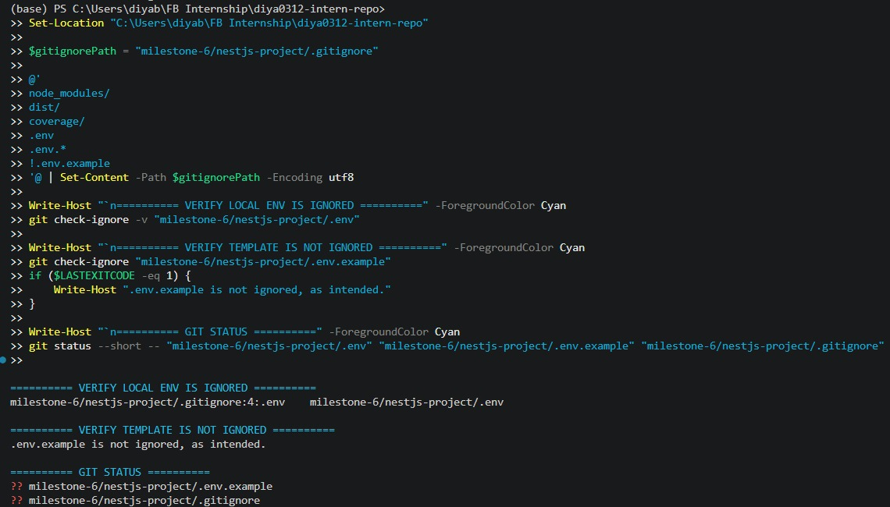
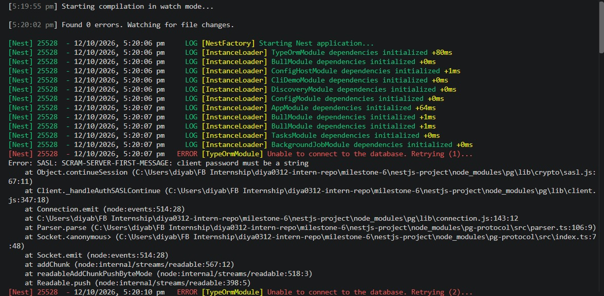

# Handling Environment Variables & Configuration in NestJS

**Milestone:** 8  
**Issue Number:** #29  
**Date:** 11/10/2026

## Implementation

- Configured `@nestjs/config` using `ConfigModule.forRoot()` with `isGlobal: true`.
- Used a local `.env` file for environment-specific configuration values.
- Created an `.env.example` template with placeholder values rather than real credentials.
- Configured `.gitignore` to exclude `.env` files while allowing `.env.example` to be committed.
- Added Joi validation for environment variables, including `NODE_ENV`, `PORT`, and database connection settings.
- Required `DB_USERNAME` and `DB_PASSWORD` so missing values are rejected during configuration initialization.

## How does `@nestjs/config` help manage environment variables?

- `@nestjs/config` loads environment variables from a `.env` file and makes them available through `ConfigService`.
- `isGlobal: true` makes the configuration module available across the application without importing it into every module.
- Centralized configuration reduces hardcoded environment-specific values and makes the application easier to configure across environments.

## Why should secrets never be stored in source code?

- Database passwords, API keys, and client secrets should not be hardcoded in source files.
- Committing secrets to version control can expose them to other people who have repository access.
- A local `.env` file keeps machine-specific values separate from application code.
- `.gitignore` helps prevent accidental commits of local secrets, while `.env.example` documents required variable names using safe placeholders.

## How can environment variables be validated before the app starts?

- A validation schema can be configured through `ConfigModule.forRoot()`.
- Joi checks required values and validates values such as `PORT` and `DB_PORT`.
- Requiring `DB_USERNAME` and `DB_PASSWORD` prevents the application from starting with those values missing or empty.
- Build and startup validation checks are used to verify the implementation.

## How can configuration be separated across environments?

- Different environment variables can be supplied for development, testing, staging, and production.
- Each environment can use its own environment variables or environment-specific configuration.
- Production secrets should be supplied through the deployment environment or a secrets manager rather than committed to the repository.
- The same application code can then run in different environments without hardcoding environment-specific values.

## Screenshots

## Reflection

This issue helped me understand how environment variables make an application easier to configure and safer to maintain. I learned how `@nestjs/config` loads configuration centrally and how Joi validation can reject missing or invalid values before the application starts.

I also learned the difference between `.env` and `.env.example`. The local `.env` file can contain machine-specific values and secrets, whereas `.env.example` documents the expected variables without exposing real credentials. Configuring `.gitignore` to exclude `.env` helps prevent accidental exposure of local secrets while keeping the safe template available in version control.

Finally, separating configuration from application code makes it easier to run the same application across development, testing, staging, and production environments. Requiring database credentials through validation also makes configuration errors easier to identify during startup.
