# Logging and Error Handling in NestJS

**Milestone:** 8  
**Issue Number:** #27  
**Date:** 12/10/2026

## Implementation

- Installed `nestjs-pino` and `pino-http` for structured logging.
- Configured `LoggerModule.forRoot()` to enable Pino HTTP logging.
- Configured log levels based on the environment and redaction of authorization and cookie headers to reduce the risk of exposing sensitive information.
- Registered the Pino logger with the NestJS application.
- Created a custom `HttpExceptionFilter` to handle HTTP exceptions and unexpected errors.
- Registered the exception filter globally so API errors use a consistent JSON response format.
- Preserved the existing validation pipe, logging interceptor, and application modules.

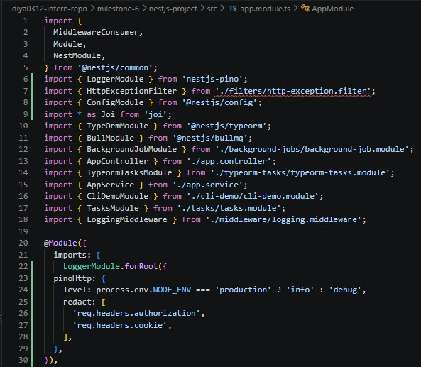

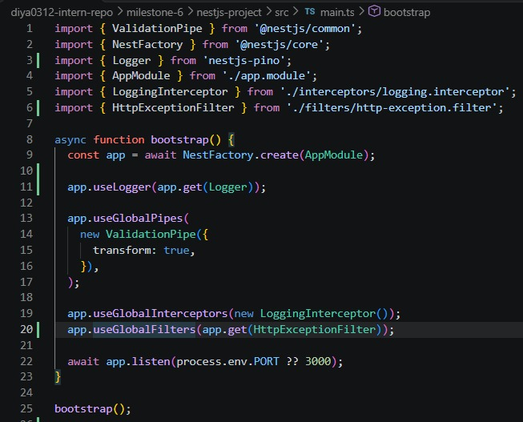

## How does `nestjs-pino` help with structured logging?

- `nestjs-pino` integrates Pino logging with NestJS and supports structured log entries.
- Structured logs record information in fields, making them easier to search, filter, and analyse.
- HTTP logging helps capture request information and investigate application behaviour.
- Configurable log levels help control the amount of logging in development and production.
- Redacting authorization and cookie headers helps reduce the risk of sensitive information appearing in logs.

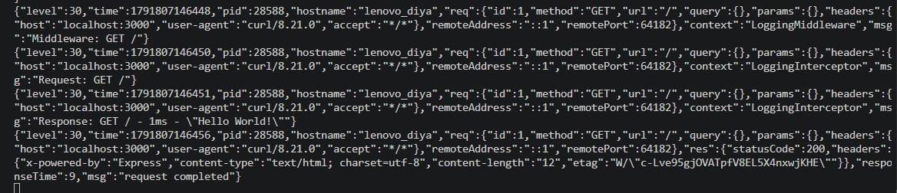

## How does global exception handling improve API consistency?

- A global exception filter handles exceptions from a central location.
- The custom filter returns a consistent JSON response containing `statusCode`, `timestamp`, `path`, and `message`.
- HTTP exceptions use their corresponding status codes.
- Unexpected exceptions return an internal server error response without exposing internal exception details to the API client.
- A consistent response format makes it easier for API clients to handle errors.

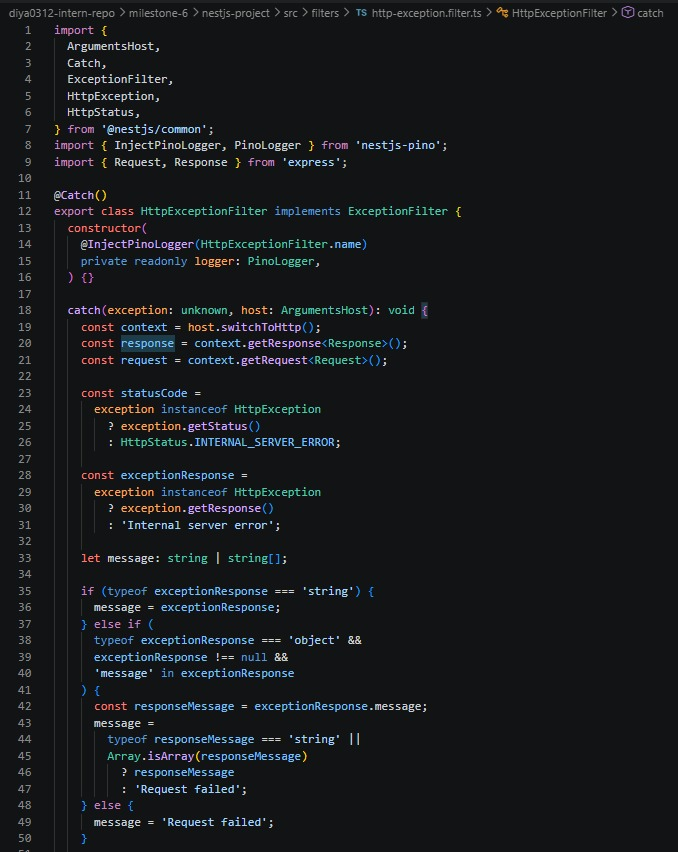

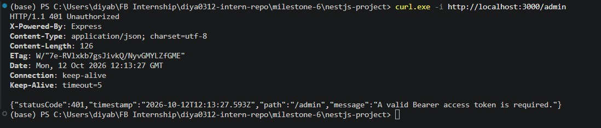

## What is the difference between a logging interceptor and an exception filter?

- A logging interceptor runs around request handling and can record request and response information.
- An exception filter handles exceptions and controls the error response returned to the client.
- The interceptor and exception filter have different responsibilities and can be used together.
- Combining request logging with centralized exception handling helps developers investigate failed requests and understand application behaviour.

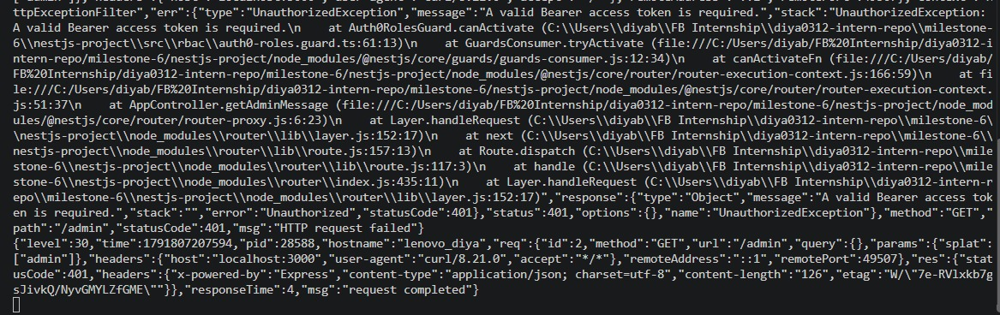

## How does structured logging make debugging easier?

- Structured logs contain named fields such as the HTTP method, request path, status code, and error details.
- Developers can filter log entries using these fields instead of searching through unstructured text.
- Request and error information helps identify failures and investigate problems more efficiently.
- Log levels help distinguish routine application activity from errors that need attention.

## Testing and Verification

- Built the NestJS project to check for compilation errors.
- Sent a request to the root endpoint to check successful request handling.
- Sent a request to the protected `/admin` endpoint without an authorization token to test error handling.
- Inspected the server logs for request information and structured error details.

**Test results:**

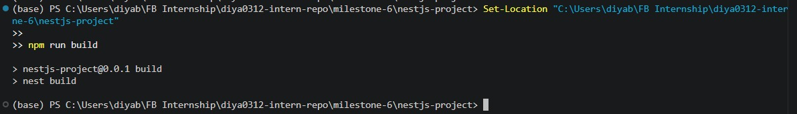

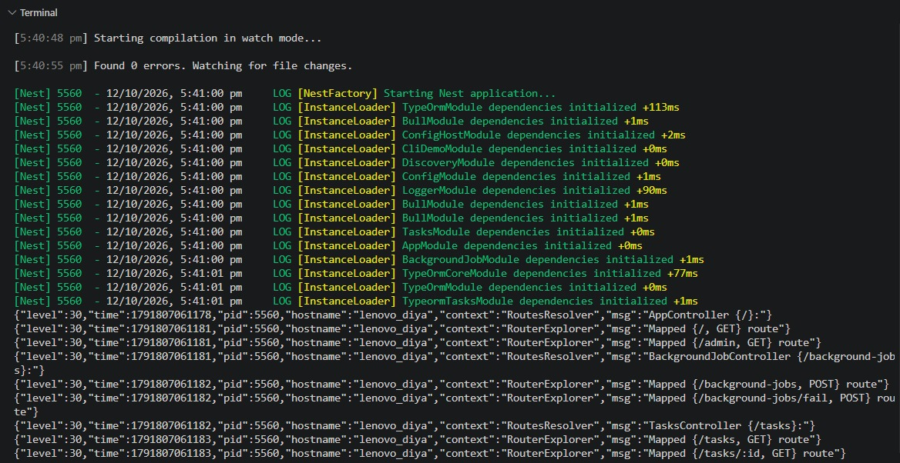

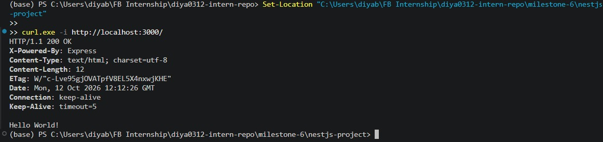

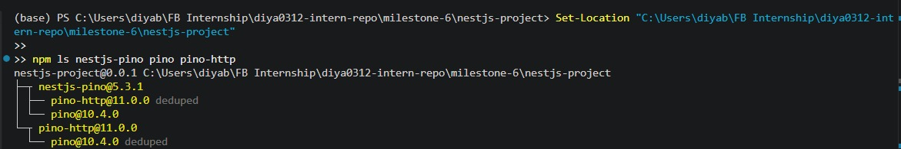

## Unexpected Error (500) Test

- The `401` test above covers a known `HttpException`. I also needed to test an **unexpected** error, the kind of bug the app doesn't plan for.
- I added a test route, `GET /error-test`, that throws a plain JavaScript `Error` (not an `HttpException`) to simulate an unexpected failure.

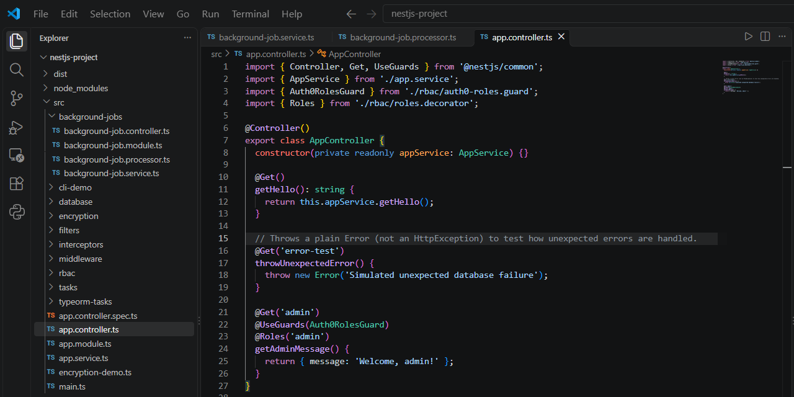

- **How I tested it:** ran the app with `npm run start:prod` and called the route with `curl.exe -i http://localhost:3000/error-test`.
- **Response the client received:**
  - Status: `HTTP/1.1 500 Internal Server Error`
  - Body: `{"statusCode":500,"timestamp":"...","path":"/error-test","message":"Internal server error"}`
  - It uses the same JSON format as the `401` response, so error responses stay consistent.
  - The real error message (`Simulated unexpected database failure`) is **not** sent to the client, so internal details stay hidden.

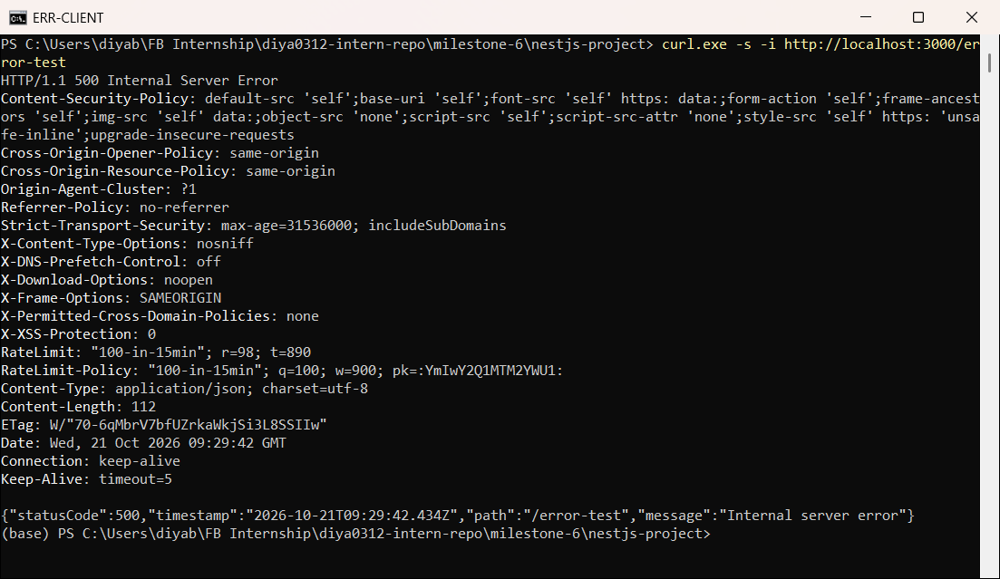

- **Structured error log on the server:** I saved the server output to a log file and pulled out the error entry. It contained:
  - `level: 50`, which is Pino's `error` level
  - `context: HttpExceptionFilter`, showing the global filter caught the error
  - `method: GET`, `path: /error-test`, `statusCode: 500`
  - `errType: Error` and `errMessage: Simulated unexpected database failure`. The real cause is kept in the logs for developers, along with the full stack trace.

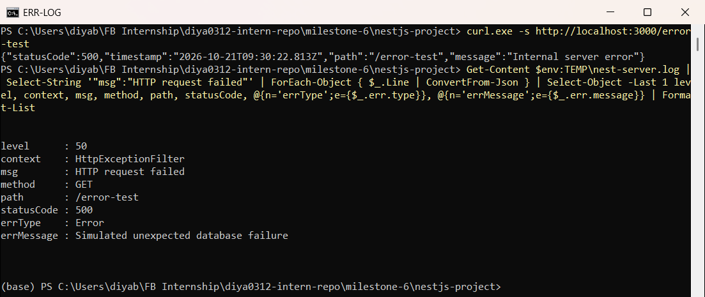

- **Result:** unexpected errors are caught by the global exception filter. The client gets a safe, consistent `500` response, and developers get a structured log with the real error details.

## Why Both `nestjs-pino` and the `LoggingInterceptor` Are Kept

- The app has two request loggers, and keeping both is intentional:
  - **`nestjs-pino` (`pino-http`)** logs every HTTP request automatically: method, URL, status code, response time and request id, with the `authorization` and `cookie` headers redacted. This is the main structured log for this issue.
  - **`LoggingInterceptor`** was built in issue #39 (*NestJS Interceptors & Middleware*, milestone 7) as my interceptor example, and that approved issue's screenshots depend on it. It logs **inside** the route handler: how long the handler took and what it returned.
- **The interceptor does not write separate, unstructured logs:**
  - `main.ts` calls `app.useLogger(app.get(Logger))`, which makes Nest's `Logger` use `nestjs-pino`.
  - So the interceptor's messages are written as **Pino JSON**, with `"context":"LoggingInterceptor"` and the **same request id** as the `pino-http` entry.
  - Both entries can be filtered and matched by request id, so they read as one structured log, not as two separate logging systems.
- **The two loggers record different information:**
  - `pino-http`: the final HTTP status and total response time, including middleware and serialization.
  - `LoggingInterceptor`: handler-level timing, plus the value the controller returned before it was sent, which helps when debugging a handler.
- **About logging response bodies:**
  - In this learning project, the responses are demo data (sample tasks, BullMQ job info) with no passwords, tokens or personal data, and the auth headers are redacted by Pino's `redact` setting.
  - In production I would **not** log full response bodies. I'd log only the method, URL and timing, or switch the interceptor to `PinoLogger` at `debug` level, so sensitive data can't end up in the logs and the request isn't logged twice.

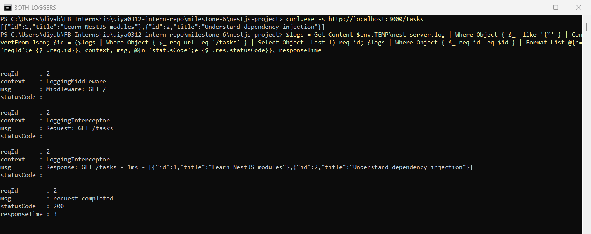

- **What the screenshot shows:** I sent one `GET /tasks` request and filtered the server log by its request id (`2`). All four entries are Pino JSON with the same id:
  - `LoggingMiddleware`: the middleware from issue #39, logged before the route runs
  - `LoggingInterceptor`: `Request: GET /tasks`
  - `LoggingInterceptor`: `Response: GET /tasks - 1ms - [...]`, the handler time and returned data
  - `pino-http`: `request completed`, with `statusCode: 200` and `responseTime: 3`
- This shows the interceptor logs go through `nestjs-pino` and are linked to the `pino-http` entry by request id, so they add handler-level detail instead of a second, disconnected log.

## Reflection

This issue helped me understand how structured logging and global exception handling improve the maintainability and debugging of a NestJS application. I learned how `nestjs-pino` provides structured logs that are easier to search and analyse, and how configurable log levels help manage application logging.

I also learned the difference between a logging interceptor and an exception filter. An interceptor can record request and response information, whereas an exception filter handles errors and returns a consistent response to the API client. Using both helps with troubleshooting while keeping error responses predictable.

Finally, implementing a global exception filter helped me understand how HTTP exceptions and unexpected errors can be handled centrally. Returning a consistent JSON response makes API behaviour easier for clients to manage, while structured error logs help developers investigate failures without exposing internal exception details to users.
