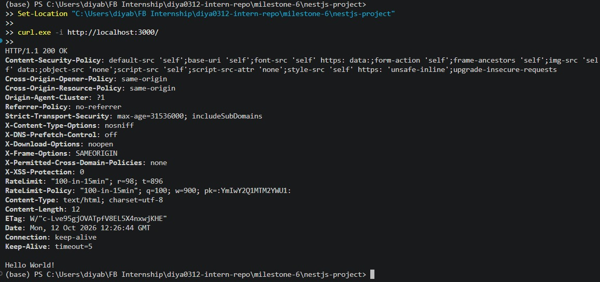
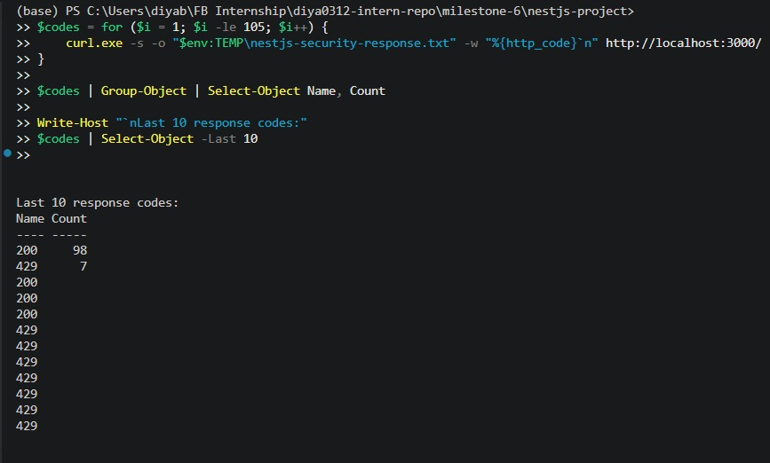
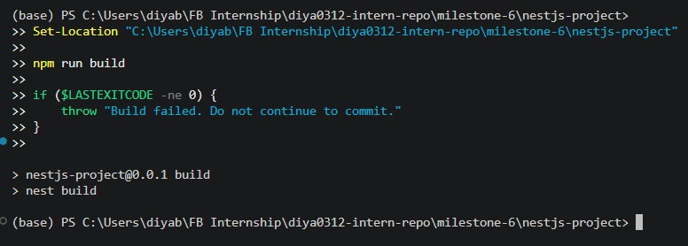

# Security Best Practices in NestJS

**Milestone:** 8  
**Issue Number:** #26  
**Date:** 12/10/2026

## Implementation

- Researched common NestJS security risks, including injection attacks, cross-site scripting (XSS), cross-site request forgery (CSRF), insecure CORS configuration, and abuse of public endpoints.
- Added Helmet middleware to configure HTTP security headers.
- Added request rate limiting with `express-rate-limit`, using a limit of 100 requests per 15-minute window.
- Configured the rate limiter to return HTTP `429 Too Many Requests` when the request limit is exceeded.
- Preserved the existing NestJS logging, validation, and exception-handling setup.
- Verified the existing environment-file protection rules: `.env` files are excluded from version control, while `.env.example` provides a safe template without real secrets.

## How does Helmet improve application security?

Helmet sets HTTP response headers that help reduce risks such as clickjacking, MIME-type sniffing, and certain cross-site scripting attacks. Its headers provide useful browser-side protections, but they do not replace input validation, output encoding, authentication, or authorization.

## Why is rate limiting important?

Rate limiting restricts how frequently a client can send requests within a defined time window. It helps reduce excessive requests, automated abuse, and some denial-of-service attempts. The configured limit is 100 requests per 15 minutes, after which the application should return HTTP `429 Too Many Requests`.

## How can sensitive configuration values be protected?

- API keys, database passwords, and client secrets should not be hardcoded in application source files.
- Local `.env` files should be excluded from version control.
- `.env.example` should document required variable names using placeholder values only.
- Production secrets should be provided through deployment environment variables or a secrets manager.
- CORS should allow only the origins required by the application, and user input should be validated to reduce injection risks.

The existing `.gitignore` rules and `.env.example` template were inspected as part of this task.

## Testing and Verification

- Built the NestJS project to check for compilation errors.
- Inspected the root endpoint response headers to verify Helmet.
- Sent repeated requests to verify whether the rate limiter returns HTTP `429`.
- Checked that the local `.env` file is ignored by Git and reviewed the example environment template.

**Test results:** Record the actual build result, security-header result, and rate-limit result before committing this report.

## Reflection

This issue helped me understand how security middleware can protect a NestJS backend. Helmet adds security-related HTTP headers, while rate limiting helps control excessive requests and reduce automated abuse. I also learned that these measures are only part of a wider security strategy and should be combined with validation, authentication, authorization, and appropriate CORS configuration.

I learned the importance of protecting sensitive configuration values by keeping real credentials out of source code and version control. A local `.env` file can hold machine-specific values, while `.env.example` documents the required variables without exposing secrets. In production, sensitive values should be supplied through environment configuration or a secrets manager.
