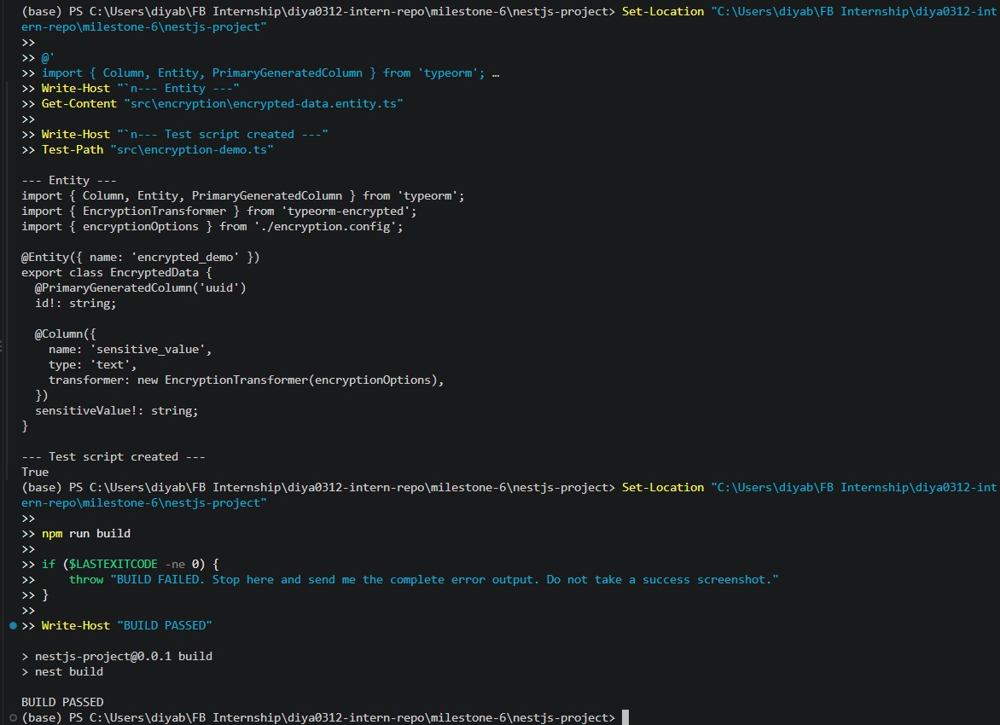
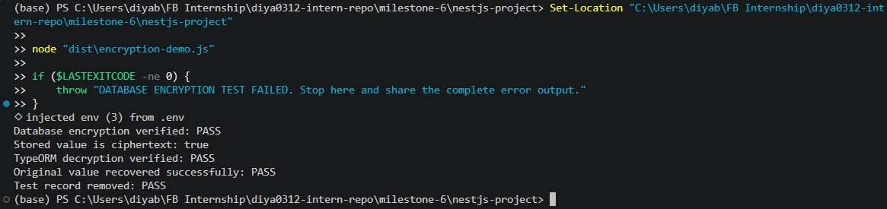

# Using `typeorm-encrypted` for Data Encryption

**Milestone:** 8  
**Issue Number:** #25  
**Date:** 12/10/2026

## Objective

Research and test field-level encryption with `typeorm-encrypted` in a NestJS application using TypeORM and PostgreSQL.

## Implementation

- Created an `EncryptedData` entity with an encrypted `sensitiveValue` column.
- Configured `EncryptionTransformer` to encrypt the value before persistence and decrypt it during entity retrieval.
- Configured AES-256-GCM with a 32-byte key loaded from the local environment.
- Added `ENCRYPTION_KEY` validation to the application configuration.
- Kept the real encryption key in the local `.env` file and used a placeholder in `.env.example`.
- Created a dedicated test script to check database ciphertext and TypeORM decryption.

## How does `typeorm-encrypted` work?

The package provides a TypeORM transformer that encrypts a field before it is stored and decrypts it when the entity is loaded. Application code can use the original value, while the database stores ciphertext.

Transformers operate in the application rather than inside the database engine. As a result, searching, sorting, or filtering encrypted values requires careful design.

## Why does Focus Bear double encrypt sensitive data?

Database encryption at rest protects database files and storage media. Application-level field encryption adds another layer by storing selected values as ciphertext.

This can reduce exposure if someone obtains database contents without access to the application's encryption key. It does not protect against every threat, particularly if the application or its key is compromised.

## How does `typeorm-encrypted` integrate with TypeORM entities?

The `EncryptionTransformer` is configured using the TypeORM column's `transformer` option. TypeORM invokes the transformer when writing and retrieving entity values.

The database stores the encrypted representation, while a normal entity retrieval returns the decrypted value when the correct key is available.

## What are the best practices for managing encryption keys?

- Keep keys out of source code and version control.
- Use environment configuration for local development and a secrets manager or key-management service for production.
- Restrict key access and never print secrets in logs.
- Back up keys securely and plan key rotation.
- Preserve access to the correct key for existing encrypted records.
- Keep `.env.example` limited to placeholders.

## What are the trade-offs between database-level and application-level encryption?

Database-level encryption at rest helps protect database files and storage media. However, a database connection with sufficient privileges may still retrieve plaintext.

Application-level field encryption protects selected values in their stored form without requiring the database to know the plaintext. It introduces additional key-management responsibilities and can limit searching, indexing, sorting, and filtering on encrypted columns.

## Build Verification

The NestJS project build was executed before the database test.

## Encryption and Decryption Verification

The test stored a sample value, inspected the raw database value, retrieved the entity through TypeORM, checked that the original value was recovered, and removed the temporary test record.

## Dependency Compatibility Note

The installed `typeorm-encrypted` version declares a peer dependency on TypeORM `^0.3.7`, while this project uses TypeORM `1.1.x`. Installation with `--legacy-peer-deps` bypasses npm's peer-dependency check but does not establish official compatibility. The build and runtime test results must be verified, and this dependency compatibility issue should be resolved before treating the implementation as production-ready.

## Reflection

This issue helped me understand the difference between database encryption at rest and application-level field encryption. I learned how a TypeORM transformer can encrypt values before storage and decrypt them during retrieval, while also understanding why encrypted fields can be harder to search and filter.

I also learned that encryption depends on careful key management. Keys must be kept out of source control, protected from unauthorized access, backed up securely, and available when encrypted data needs to be read. Finally, I learned that a successful package installation or build alone is not enough: runtime testing and dependency compatibility checks are important before relying on an encryption library.
