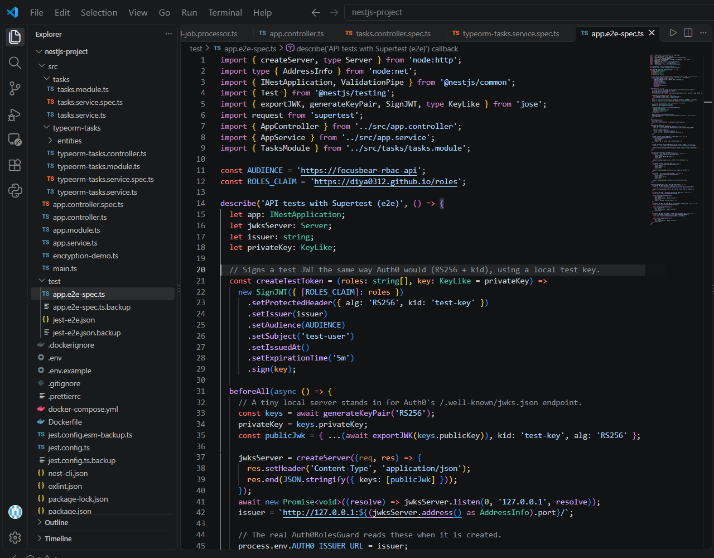
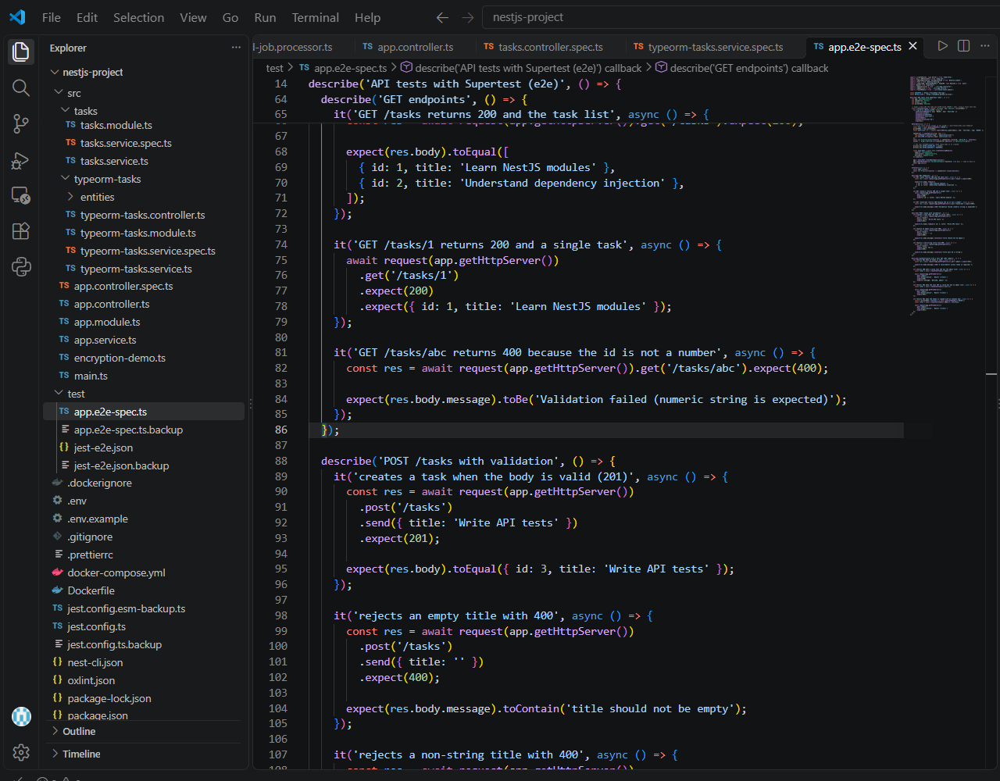
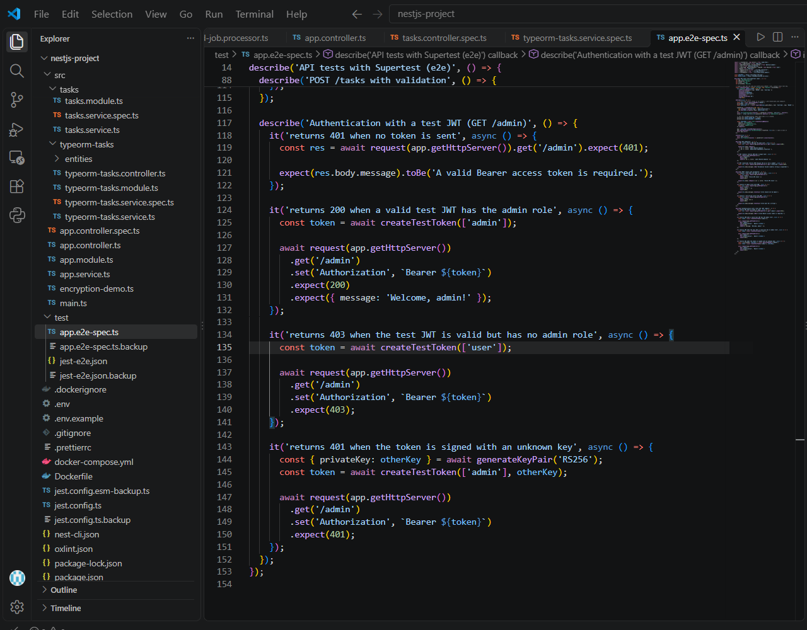
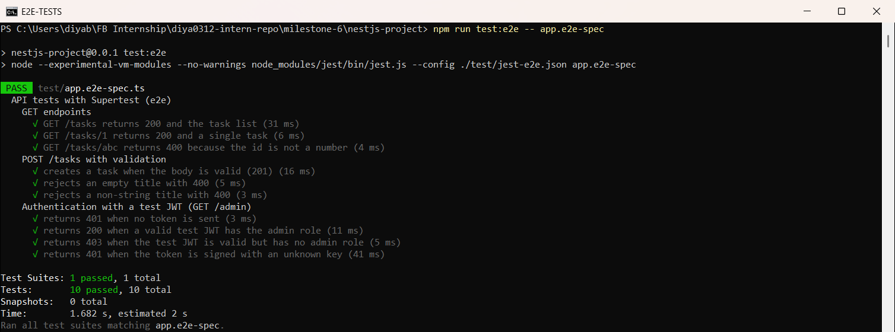

# Using Jest & Supertest for API Testing in NestJS  

**Milestone:** 9  
**Issue Number:** #20  
**Date:** 18/10/2026  

## What I Did

- Rewrote `test/app.e2e-spec.ts` in my NestJS project (`milestone-6/nestjs-project`) to test the **real** API endpoints with Supertest.
- Tested `GET` endpoints, a `POST` endpoint with validation, and a **protected route using a test JWT**.
- Ran the suite with `npm run test:e2e -- app.e2e-spec`. **10 tests passed.**

## How Supertest Is Used in NestJS

- `Test.createTestingModule()` loads the real `TasksModule` and `AppController`.
- `createNestApplication()` turns it into a real NestJS app, without listening on a port.
- I added the same `ValidationPipe` as `main.ts`, so validation works exactly like the real app.
- `request(app.getHttpServer())` lets Supertest send real HTTP requests to that app.
- Each test checks the **status code** and the **response body**.
- `app.close()` runs at the end to shut everything down cleanly.

## Mocking Authentication with a Test JWT

- `GET /admin` is protected by my real `Auth0RolesGuard`, which checks the token signature against Auth0's JWKS (public keys), then the issuer, audience and `admin` role.
- Calling the real Auth0 in tests would be slow, need internet and need real credentials, so I **mocked Auth0 instead of the guard**:
  - Generated a test RSA key pair with `jose`.
  - Started a tiny local HTTP server that serves the public key, like Auth0's `/.well-known/jwks.json`.
  - Pointed `AUTH0_ISSUER_URL` and `AUTH0_AUDIENCE` at the test values.
  - `createTestToken(roles)` signs a test JWT (RS256) with the test private key.
- This way the **real guard code runs** in the tests. Only the identity provider is fake.

## GET and POST Tests

- **GET tests:**
  - `GET /tasks` → `200` with the full task list.
  - `GET /tasks/1` → `200` with one task.
  - `GET /tasks/abc` → `400`, because `ParseIntPipe` rejects a non-numeric id.
- **POST `/tasks` with validation** (`CreateTaskDto` uses `@IsString()` and `@IsNotEmpty()`):
  - Valid body `{ title: 'Write API tests' }` → `201` and the new task `{ id: 3, ... }`.
  - Empty title `''` → `400` with the message `title should not be empty`.
  - Number title `123` → `400` with the message `title must be a string`.

## Authentication Tests (`GET /admin`)

- No token → `401` with `A valid Bearer access token is required.`
- Valid test JWT **with** the `admin` role → `200` with `{ message: 'Welcome, admin!' }`.
- Valid test JWT **without** the `admin` role → `403 Forbidden`.
- Token signed with a **different, unknown key** → `401`. This shows the guard really verifies the signature.

## Test Results

- Command: `npm run test:e2e -- app.e2e-spec` (runs only this issue's API test file)
- **Result: 1 test suite passed, 10 tests passed.**
  - 3 GET tests
  - 3 POST/validation tests
  - 4 authentication tests

## Reflection

### How does Supertest help test API endpoints?

- It sends real HTTP requests (`GET`, `POST`, headers, body) to the NestJS app without starting a server on a port.
- It makes it easy to check status codes and response bodies in one chain, e.g. `.expect(200)`.
- It tests the whole request path: routing → pipes (validation) → guards → controller → service → response.

### What is the difference between unit tests and API tests?

- **Unit tests** test one class on its own, like a controller with a mocked service. They're fast and pinpoint exactly where a bug is.
- **API tests** go through the HTTP layer with real modules wired together.
- API tests catch things unit tests miss. For example, my validation tests only work because the `ValidationPipe` and DTO decorators run together, which a controller unit test would skip.

### Why should authentication be mocked in integration tests?

- Real Auth0 calls need internet and real credentials, are slower, and can fail for reasons that have nothing to do with my code.
- With a test JWT I can easily create any user I need: an admin, a normal user, or a token signed with the wrong key.
- I mocked only the **identity provider**, not the guard, so the guard's real checks (signature, issuer, audience, role) are still tested.

### How can you structure API tests to cover both success and failure cases?

- Group tests by endpoint or feature with `describe()` blocks (GET, POST validation, authentication).
- For each endpoint, test the **happy path** plus the main **failure paths**:
  - invalid input → `400`
  - not logged in → `401`
  - logged in but not allowed → `403`
- Check the response body or error message too, not just the status code.
- Set up shared things once in `beforeAll()` and clean up in `afterAll()`.
