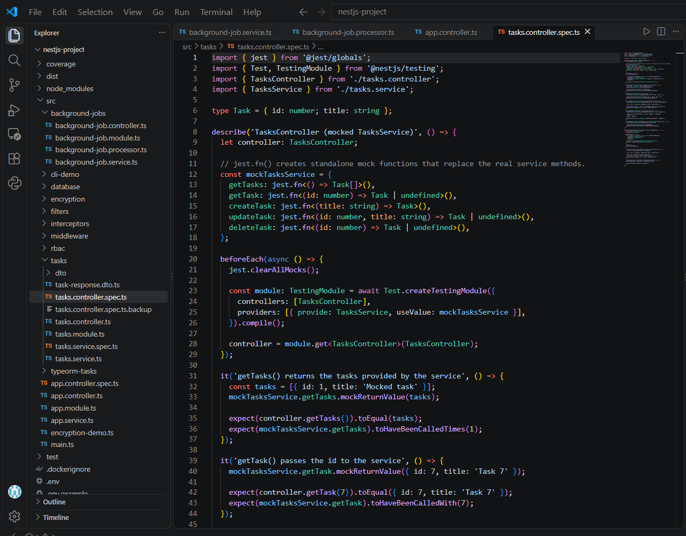
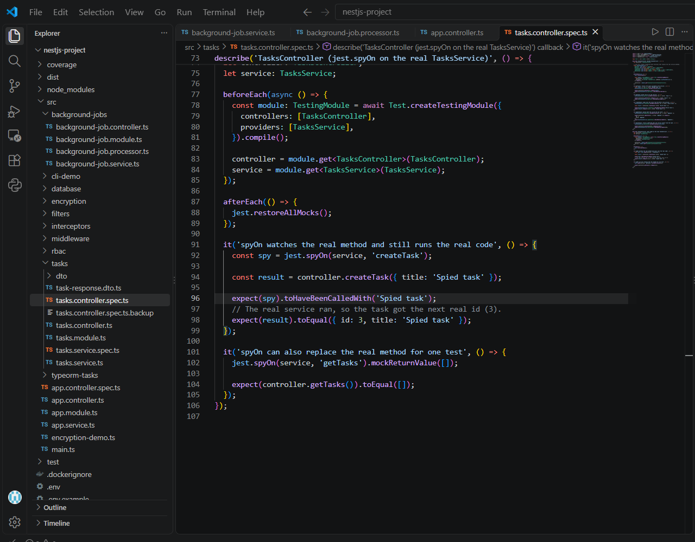
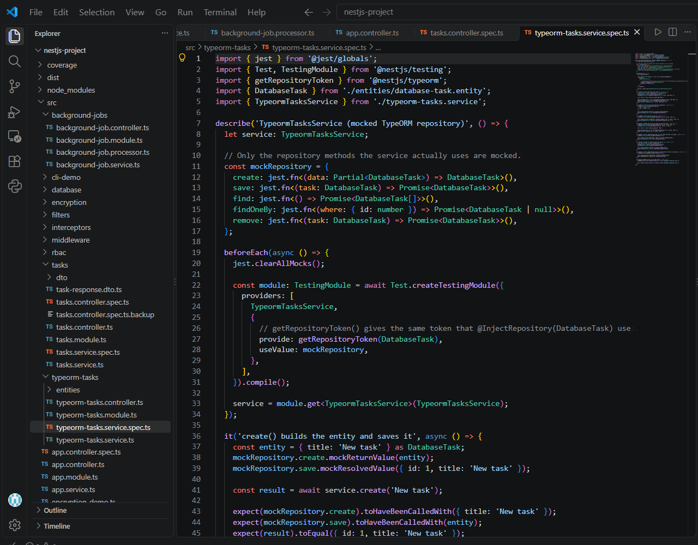
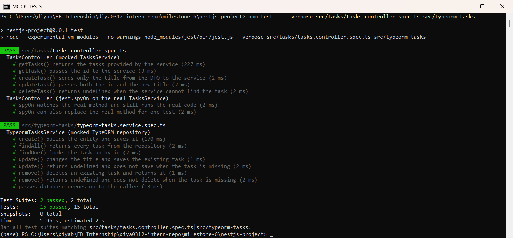

# Mocking Dependencies & Database Interactions in NestJS  

**Milestone:** 9  
**Issue Number:** #21  
**Date:** 18/10/2026  

## What I Did

- Worked in my NestJS project (`milestone-6/nestjs-project`).
- Rewrote `src/tasks/tasks.controller.spec.ts` to test the controller with a **mocked `TasksService`**.
- Added a **`jest.spyOn()`** example in the same file, using the real `TasksService`.
- Created `src/typeorm-tasks/typeorm-tasks.service.spec.ts` to test the service with a **mocked TypeORM repository** using `getRepositoryToken()`.
- Ran the tests with Jest. **15 tests passed.**

## How Mocking Works in NestJS

- `Test.createTestingModule()` from `@nestjs/testing` builds a small NestJS module just for the test.
- Inside it, any provider can be swapped for a fake version using `{ provide: Token, useValue: mock }`.
- The class being tested still uses dependency injection as usual, but it receives the mock instead of the real dependency.
- `jest.mock('path')` can also replace a whole imported module. In NestJS, swapping providers is usually simpler because DI already gives us a place to plug in the mock.

## Mocking a Service in a Controller Test

- `TasksController` depends on `TasksService`.
- I created `mockTasksService`, where every method is a `jest.fn()`.
- I registered it with `{ provide: TasksService, useValue: mockTasksService }`.
- `jest.clearAllMocks()` runs before each test so call counts don't leak between tests.

- **What the controller tests check:**
  - `getTasks()` returns exactly what the mock returns, and the mock is called once.
  - `getTask(7)` passes `7` to `service.getTask`.
  - `createTask({ title })` sends **only the title** to `service.createTask`.
  - `updateTask(1, { title })` passes both the id and the new title.
  - `deleteTask(99)` returns `undefined` when the service can't find the task.
- Each test checks **what the controller sends to the service** (`toHaveBeenCalledWith`) and **what it returns** (`toEqual`), not just that the controller exists.

## `jest.fn()` vs `jest.spyOn()`

- **`jest.fn()`**
  - Creates a brand-new fake function that has no real code behind it.
  - Used above to build the whole mock `TasksService`.
  - Best when the real dependency should not run at all, e.g. a database or external API.
- **`jest.spyOn(object, 'method')`**
  - Wraps a method on a **real** object.
  - By default the real code still runs, and Jest records how the method was called.
  - It can also be overridden for one test with `.mockReturnValue()`.
  - `jest.restoreAllMocks()` puts the original method back after each test.

- **My two `spyOn` tests:**
  - **Spy only:** spied on `service.createTask`, then called the controller. The spy confirmed it was called with `'Spied task'`, and the **real** service still ran, so the new task got the real next id (`3`).
  - **Spy + replace:** `jest.spyOn(service, 'getTasks').mockReturnValue([])` replaced the real method for just that test, so the controller returned `[]`.

## Mocking a TypeORM Repository in a Service Test

- `TypeormTasksService` uses `@InjectRepository(DatabaseTask)` to get a `Repository<DatabaseTask>`.
- `getRepositoryToken(DatabaseTask)` returns the **same token** NestJS uses for that repository, so I can swap in my own mock.
- The mock only has the repository methods the service actually uses: `create`, `save`, `find`, `findOneBy` and `remove`, each a `jest.fn()`.
- No database connection is needed. These tests ran without Postgres.

- **What the service tests check:**
  - `create()` calls `repository.create({ title })`, then `repository.save()` with that entity.
  - `findAll()` returns what `repository.find()` resolves.
  - `findOne(5)` calls `findOneBy({ id: 5 })`.
  - `update()` changes the title and saves, but returns `undefined` and **does not call `save`** when the task is missing.
  - `remove()` deletes the task, but returns `undefined` and **does not call `remove`** when the task is missing.
  - A database error (`mockRejectedValue`) is passed back up to the caller.

## Test Results

- Command: `npm test -- --verbose src/tasks/tasks.controller.spec.ts src/typeorm-tasks`
- **Result: 2 test suites passed, 15 tests passed.**
  - 5 tests: controller with mocked service
  - 2 tests: `jest.spyOn` examples
  - 8 tests: service with mocked TypeORM repository

- **Note:** NestJS 12 is ESM-only, so I updated the `test` scripts in `package.json` to run Jest with `node --experimental-vm-modules`. In ESM mode, `jest` is imported from `@jest/globals`.

## Reflection

### Why is mocking important in unit tests?

- It tests **one class at a time**. If a controller test fails, the problem is in the controller, not in the service or database.
- Tests run fast: my 15 tests finished in about 2 seconds with no database running.
- It makes hard cases easy to test, like "task not found" or "database connection lost", just by changing what the mock returns.

### How do you mock a NestJS provider (e.g. a service in a controller test)?

- Create an object with `jest.fn()` for each method the controller uses.
- Register it in `Test.createTestingModule()` with `{ provide: TasksService, useValue: mockTasksService }`.
- In each test, set the return value (`mockReturnValue`), call the controller, then assert the result **and** the call (`toHaveBeenCalledWith`).

### What are the benefits of mocking the database instead of using a real one?

- No Postgres, Docker or migrations needed to run the tests.
- Tests are fast and give the same result every run, with no leftover data.
- Edge cases like `null` results and errors are easy to simulate.
- **Limit:** a mocked repository doesn't check real SQL, column names or constraints. That still needs integration tests against a real database.

### How do you decide what to mock vs. what to test directly?

- **Test directly:** the class's own logic, e.g. the service's "if task not found, return undefined" check.
- **Mock:** things outside the class, such as repositories, other services, queues and external APIs.
- **Use `spyOn`** when I want the real code to run but still check that it was called correctly.
- **Never mock the thing being tested.** Otherwise the test only proves the mock works.
