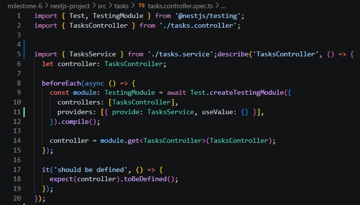
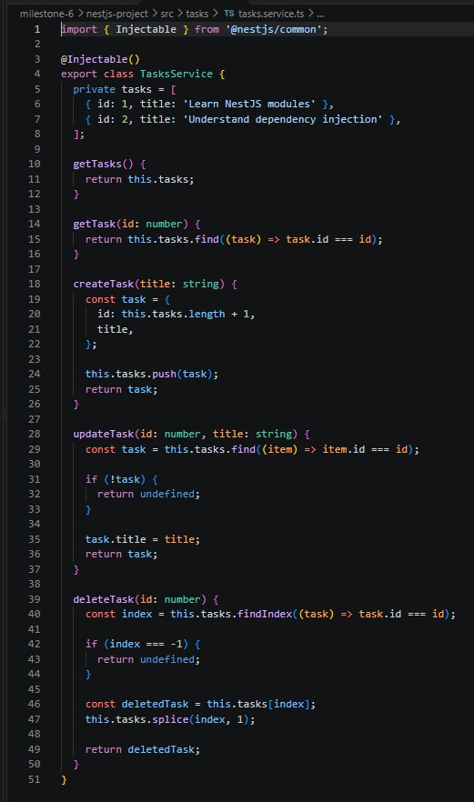
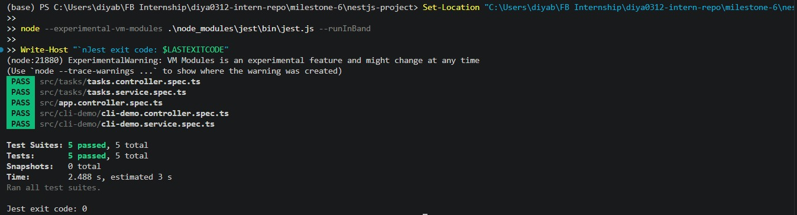

# Mocking Dependencies & Database Interactions in NestJS

- **Milestone:** 9
- **Issue:** #21
- **Date:** 18/10/2026

## Objective

- Learn how to mock dependencies in NestJS tests.
- Understand how `@nestjs/testing` configures mock providers.
- Learn how a TypeORM repository can be mocked in a service test.
- Understand the differences between `jest.fn()` and `jest.spyOn()`.

## 1. Why Mock Dependencies?

- Mocking replaces a real dependency with a controlled test version.
- It helps test one component without relying on other components or external services.
- Mocked dependencies can return predictable values or simulate errors.
- This makes unit tests faster, more reliable, and easier to run repeatedly.

## 2. Mocking a Service in a Controller Test

- A controller often depends on a service to perform application logic.
- A controller unit test can provide a mock service instead of the real service.
- The mock can be registered as a provider in `Test.createTestingModule()`.
- The controller can then be tested without running the service's real implementation.
- Jest mock functions can be used to configure return values and check whether methods were called.

- This screenshot should show the actual controller test and its configured mock provider.

## 3. Mocking a TypeORM Repository in a Service Test

- A service may use a TypeORM repository to read or modify database records.
- A unit test can replace the real repository with a mock object.
- NestJS provides `getRepositoryToken()` to identify the repository provider for an entity.
- The test module can register a mock repository using that token.
- Repository methods such as `find`, `findOne`, `save`, or `delete` can be mocked when the service uses them.
- The mock should contain the methods required by the service being tested.
- This approach avoids connecting to a real database during a unit test.

- This screenshot should show the actual service test and repository mock setup.

## 4. `jest.fn()` vs `jest.spyOn()`

- `jest.fn()` creates a standalone mock function.
- It is useful when creating a mock dependency or defining a function's test behaviour.
- `jest.spyOn(object, 'method')` creates a spy on an existing method of an object.
- A spy can help check whether a method was called and with which arguments.
- A spy calls the original method by default unless its implementation is replaced.
- Use `mockImplementation()` or `mockResolvedValue()` when the test needs controlled behaviour.
- Restore spies after tests when necessary to prevent one test from affecting another.

## 5. Running the Tests

- Jest runs the test files and reports which test cases pass or fail.
- Tests should be checked against the actual terminal output.
- A passing unit test confirms the behaviour covered by that test; it does not prove that every application scenario works.
- The screenshot below should contain the real test output from this project.

## 6. Reflection

### Why is mocking important in unit tests?

- Mocking isolates the component being tested from its dependencies.
- It makes tests faster and reduces dependence on databases, network services, and other external systems.
- It allows predictable results and makes it easier to test error conditions.

### How do you mock a NestJS provider, such as a service in a controller test?

- Create a mock object or Jest mock functions for the methods the controller calls.
- Register the mock in `Test.createTestingModule()` using the provider token for the dependency.
- Retrieve the controller from the compiled testing module and test its behaviour.
- Verify the returned result and, where appropriate, whether the mock methods were called.

### What are the benefits of mocking the database instead of using a real one?

- Tests can run without starting or connecting to a database.
- They are generally faster and easier to repeat.
- Test data and repository responses can be controlled.
- Database setup and cleanup are not required for these isolated unit tests.
- However, repository mocks do not verify real SQL queries, database constraints, or actual database integration. Those need suitable integration tests.

### How do you decide what to mock versus what to test directly?

- Test the component's own logic directly.
- Mock external dependencies that are outside the component's responsibility, such as repositories, external APIs, or services called by a controller.
- Keep the mock behaviour relevant to the scenario being tested.
- Use integration tests when the goal is to verify that multiple real components work together.
- Avoid mocking the exact behaviour that the test is supposed to verify.

## 7. Conclusion

- Mocking helps isolate NestJS services and controllers during unit testing.
- `@nestjs/testing` can register mock providers in a testing module.
- TypeORM repository tokens can be used to supply repository mocks.
- `jest.fn()` creates mock functions, while `jest.spyOn()` observes or replaces an existing method.
- Actual test results should be recorded from the terminal, and database integration should be tested separately when required.
