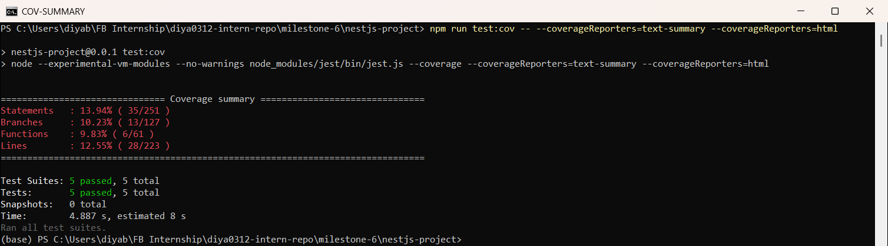
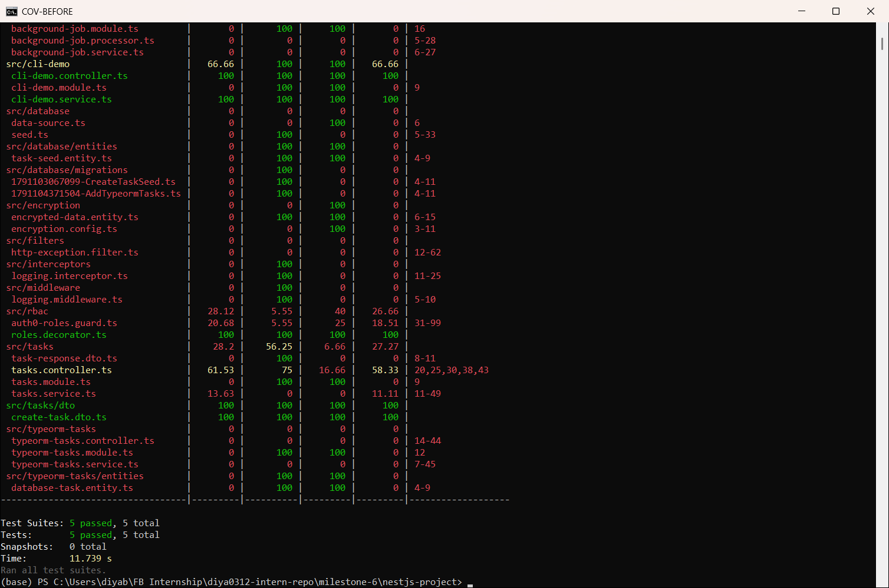
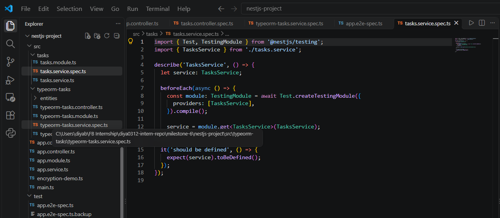
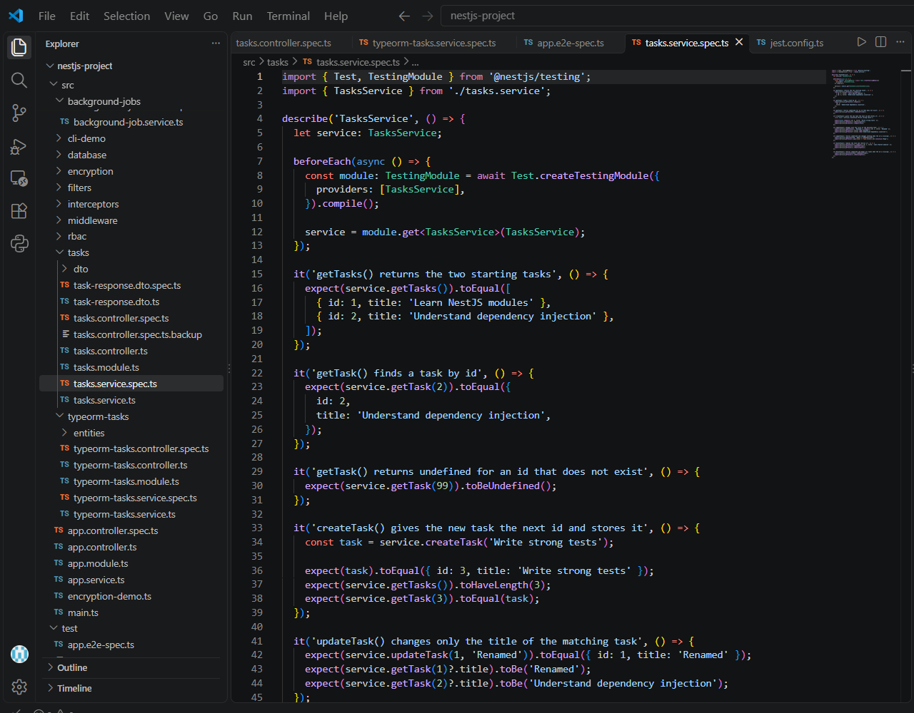
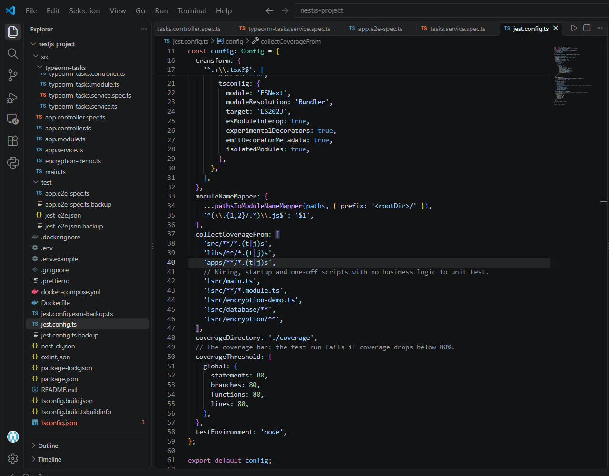
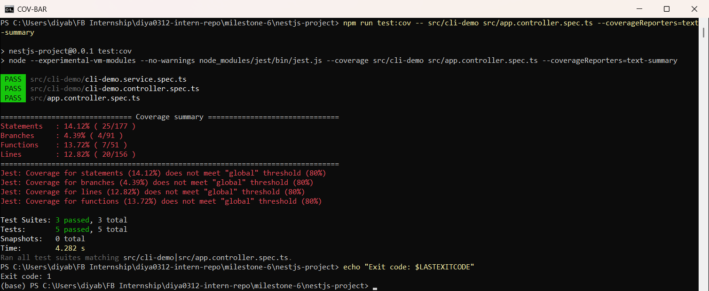
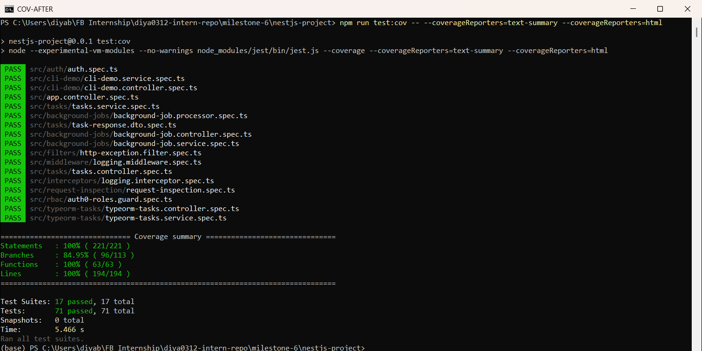
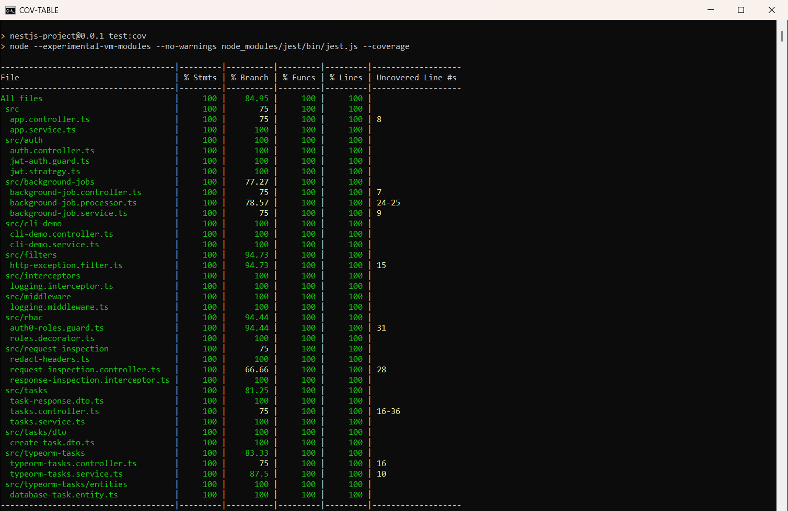
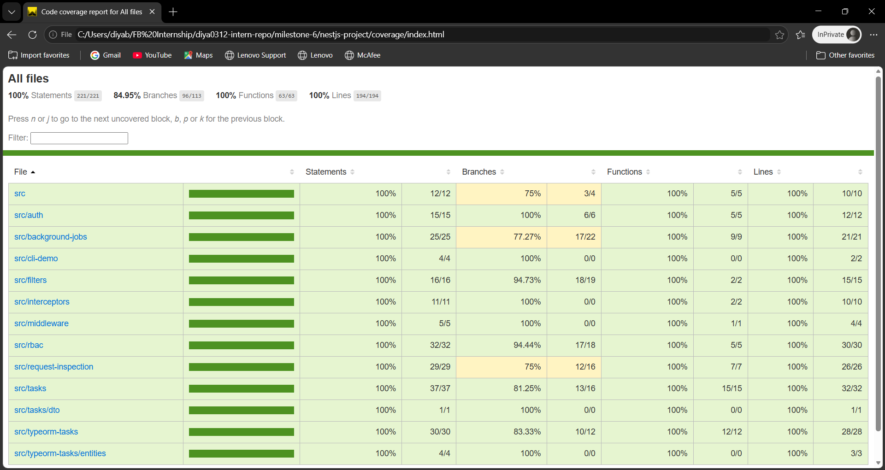

# Understanding the Focus Bear Coverage Bar & Writing Meaningful Tests  

**Milestone:** 9  
**Issue Number:** #19  
**Date:** 21/10/2026  

## What I Did

- Ran the test suite with coverage on my NestJS project (`milestone-6/nestjs-project`) and checked the report.
- Found the untested areas and wrote new tests for them.
- Refactored a weak test (`should be defined`) into one with real assertions.
- Added an **80% coverage bar** (`coverageThreshold`) to `jest.config.ts`.
- **Result:** coverage went from **13.94% → 100% statements** (84.95% branches), and the tests grew from **5 → 71**.

## How Jest Generates Coverage Reports

- `npm run test:cov` runs Jest with `--coverage`.
- Jest (using Istanbul) tracks which code actually ran during the tests.
- It reports 4 numbers:
  - **Statements:** how many code statements ran
  - **Branches:** how many `if`/`else`, `??` and `? :` paths ran
  - **Functions:** how many functions were called
  - **Lines:** how many lines ran
- `collectCoverageFrom` in `jest.config.ts` decides which files are counted.
- Reports can be printed as a table (`text`), a short summary (`text-summary`) or a website (`html` in `coverage/index.html`).

## Coverage Before

- At the start, coverage was only **13.94% statements** with 5 tests.

- **Untested areas I found in the table** (0% or very low):
  - `tasks.service.ts`: 13.63%
  - `http-exception.filter.ts`, `logging.interceptor.ts`, `logging.middleware.ts`: 0%
  - Everything in `background-jobs/` and `typeorm-tasks/`: 0%
  - `auth0-roles.guard.ts`: 20.68%

## Refactoring a Weak Test

- **Before:** `tasks.service.spec.ts` had only one test, `expect(service).toBeDefined()`.
  - It passes as long as the class can be created.
  - It would **still pass** if `createTask()` gave the wrong id or `deleteTask()` deleted the wrong task.

- **After:** 8 tests that check real behaviour:
  - exact values returned (`toEqual`)
  - "not found" cases return `undefined`
  - side effects, e.g. after `deleteTask(1)` the list has 1 task left and task 1 is gone
  - that updating one task doesn't change another one

## Writing Tests for the Untested Areas

- `http-exception.filter.spec.ts`: checks status codes, validation message arrays, the fallback message, and that a `500` hides the real error but still logs it.
- `logging.interceptor.spec.ts` / `logging.middleware.spec.ts`: check the log messages and that the request or response is passed on unchanged.
- `background-job.service.spec.ts`: mocks the BullMQ queue (`getQueueToken`) and checks the job name, data and retry options.
- `background-job.processor.spec.ts`: uses fake timers to test success, failure, and the "will retry" vs "no retries left" logs.
- `background-job.controller.spec.ts`, `typeorm-tasks.controller.spec.ts`: controllers with mocked services.
- `auth0-roles.guard.spec.ts`: no token, missing config, invalid token, wrong role, and correct role, using test JWTs.
- `task-response.dto.spec.ts`: checks that `@Exclude()` hides `internalNote` from API responses.
- `request-inspection.spec.ts`: checks header redaction, the 404 fix and the response-inspection interceptor (this code was added for issue #17 in milestone 10).
- `auth.spec.ts`: checks the Auth0 issuer handling, `JwtStrategy.validate()` and the auth controller (added for issue #31).

## Setting Up the Coverage Bar

- Added `coverageThreshold` with **80%** for statements, branches, functions and lines.
- If coverage drops below 80%, `npm run test:cov` **fails**, even when all the tests pass.
- I left a few files out of coverage because they only wire the app together or are one-off scripts, with no logic to unit test:
  - `main.ts`, `*.module.ts`, `encryption-demo.ts`, `database/**` (migrations and seed script), `encryption/**`
  - These are better checked by running the app and by e2e tests.

- **Testing the bar:** I ran only the 3 small, older test files. All 5 tests **passed**, but coverage was 14.12%, so Jest failed the run with `does not meet "global" threshold (80%)` and **exit code 1**.

## Coverage After

- **17 test suites, 71 tests, all passed.**
- **Statements 100%, Branches 84.95%, Functions 100%, Lines 100%.** All four are above the 80% bar.

- The HTML report (`coverage/index.html`) shows the same numbers per folder, with colour bars:

- **Why branches aren't 100%:** most of the remaining "branches" are code TypeScript generates for decorators (`emitDecoratorMetadata`), not real `if` statements in my code. Chasing them would add tests with no value.

## Reflection

### What does the coverage bar track, and why is it important?

- It tracks the percentage of statements, branches, functions and lines that actually run during the tests.
- It's a minimum level (80%) that the code must reach. If coverage drops, the run fails, which can block a merge or deploy in CI.
- It stops new code being added without tests, so coverage doesn't slowly drop over time.

### Why does Focus Bear enforce a minimum test coverage threshold?

- Focus Bear's backend is used by real users on web and mobile, so untested code is a risk.
- A fixed bar like 80% makes testing part of every change, not an afterthought.
- It catches untested code automatically during review, so reviewers don't have to spot it by eye.

### How can high test coverage still lead to untested functionality?

- Coverage only shows that code **ran**, not that the result was **checked**.
- A test that calls `createTask('x')` with no `expect` gives 100% coverage of that function but checks nothing.
- My old `toBeDefined()` test is an example: the class was created and covered, but none of its behaviour was tested.
- Coverage also can't show missing code. If there's no check for a negative id at all, there's no line to show as uncovered.

### What are examples of weak vs. strong test assertions?

- **Weak:**
  - `expect(service).toBeDefined()`
  - `expect(result).toBeTruthy()`
  - only checking the status code, e.g. `.expect(200)` without the body
  - no `expect` at all
- **Strong:**
  - `expect(result).toEqual({ id: 3, title: 'Write strong tests' })`, an exact value
  - `expect(mockRepository.save).not.toHaveBeenCalled()` when the task is missing, checking a side effect
  - `expect(JSON.stringify(body)).not.toContain('Database password')`, checking a security rule
  - testing both the happy path and the error paths

### How can you balance increasing coverage with writing effective tests?

- Start with the code that matters most (services, guards, filters) instead of chasing the easiest lines.
- Each test should check a specific behaviour and fail if that behaviour breaks.
- Use the coverage report to **find gaps**, then ask "what behaviour isn't tested here?", not "how do I turn this line green?"
- Leave out wiring files that have no logic, and be honest about it in the config.
- Don't chase 100%. The last few percent (like decorator branches) often add tests with no real value.
