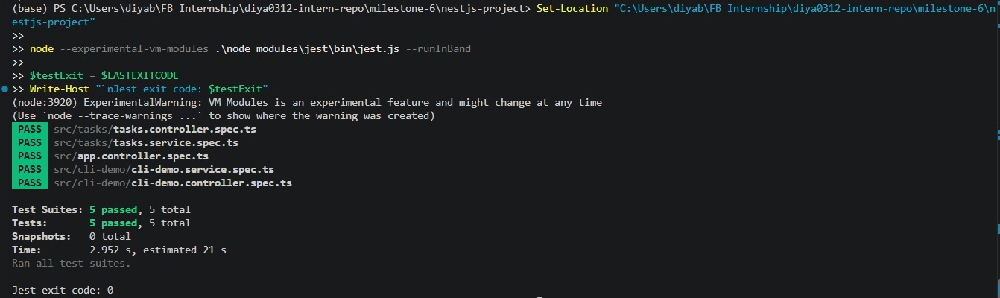
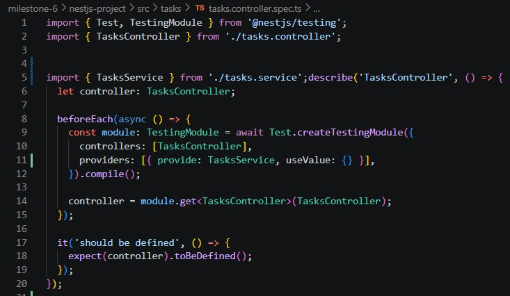
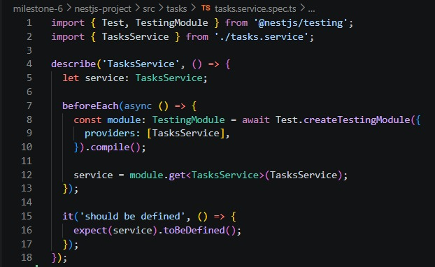

# Introduction to Testing in NestJS  

- **Milestone:** 9  
- **Issue Number:** #23    
- **Date:** 18/10/2026  

## Objective

- Understand the main types of testing used in NestJS.
- Learn how Jest runs tests and checks expected results.
- Understand how `@nestjs/testing` helps test NestJS modules.
- Run a sample Jest test and examine its actual result.

## 1. Types of Testing in NestJS

### Unit Testing

- Unit tests check one small part of an application, such as a function, service, or controller method.
- Dependencies can be replaced with mocks so the test focuses on the component being checked.
- Unit tests are usually fast and help find problems in individual components.

### Integration Testing

- Integration tests check whether multiple parts of an application work correctly together.
- For example, they may check how a service interacts with a repository or database.
- These tests can require additional setup for dependencies and external services.

### End-to-End (E2E) Testing

- E2E tests check an application flow from the outside, often by sending HTTP requests to a running NestJS application.
- They help verify that different components work together as expected.
- E2E tests can take longer to run and may require more setup than unit tests.

### Main Differences

- **Unit testing:** Checks one component in isolation.
- **Integration testing:** Checks whether connected components work together.
- **E2E testing:** Checks a complete application flow from the outside.

## 2. The Role of Jest

- Jest is a JavaScript and TypeScript testing framework commonly used in NestJS projects.
- It can run test files, group related tests, compare actual and expected values, and report failures.
- The `describe()` function groups related tests.
- The `it()` or `test()` function defines a test case.
- The `expect()` function checks whether the result matches what is expected.
- Jest reports which tests passed or failed.

- The screenshot above records the actual Jest output from this project. A test should be described as passing only when the command completes successfully and its output confirms that result.

## 3. Testing NestJS Modules with `@nestjs/testing`

- NestJS provides `@nestjs/testing` to make it easier to create a testing environment for application components.
- `Test.createTestingModule()` builds a testing module with the providers, controllers, and dependencies needed for a test.
- The testing module can replace real dependencies with mock providers.
- Calling `compile()` prepares the testing module.
- The test can retrieve an instance of a service or controller and check its behaviour.
- Mocking dependencies helps keep unit tests isolated and avoids unnecessary database or network connections.

- This screenshot shows the actual testing module setup used in the project.

## 4. Sample Test in the Project

- A sample Jest test was run using the existing NestJS project and its configured testing tools.
- The test file and its assertions are shown below.

- The test result must be interpreted from the actual Jest output. A successful result confirms only the tests that were run; it does not mean every unit, integration, and E2E scenario has been tested.

## 5. Why Testing Is Important for a NestJS Backend

- Tests help identify bugs before changes reach users.
- They check whether application components behave as expected.
- They help prevent regressions when existing code is modified.
- Automated tests can be run repeatedly during development.
- Integration and E2E tests can reveal issues that isolated unit tests may not catch.

## 6. Challenges When Writing Tests

- **Mocking dependencies:** Services may depend on repositories, other services, or external APIs.
- **Database setup:** Integration and E2E tests may need a test database and cleanup between runs.
- **Asynchronous operations:** Promises and other asynchronous work must be handled correctly.
- **Test isolation:** Tests should not depend on the order in which other tests run.
- **Maintaining tests:** Tests may need updates when application behaviour or requirements change.
- **External services:** Network services and shared resources can make tests slower or less reliable.

## 7. Reflection

### What are the key differences between unit, integration, and E2E tests?

- Unit tests check individual components in isolation.
- Integration tests check whether connected components work together.
- E2E tests check complete application flows from the outside, often through HTTP requests.

### Why is testing important for a NestJS backend?

- Testing helps catch bugs early, check expected behaviour, and prevent regressions when code changes.
- It gives developers more confidence that existing functionality still works after updates.

### How does NestJS use `@nestjs/testing` to simplify testing?

- `@nestjs/testing` provides tools such as `Test.createTestingModule()` to create a testing environment.
- It allows dependencies to be configured or replaced with mocks so services and controllers can be tested in isolation.

### What are the challenges of writing tests for a NestJS application?

- Common challenges include mocking dependencies, setting up databases, handling asynchronous code, keeping tests isolated, and maintaining tests as the application changes.

## 8. Conclusion

- This task introduced the differences between unit, integration, and E2E testing.
- It covered how Jest executes tests and how `@nestjs/testing` helps prepare NestJS components for testing.
- The recorded test result should be used to describe what actually passed.
- More integration and E2E tests can be added as the application and its test setup require them.
