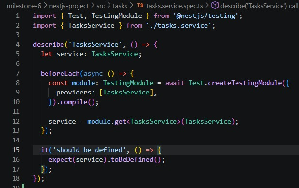
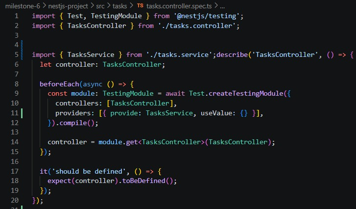
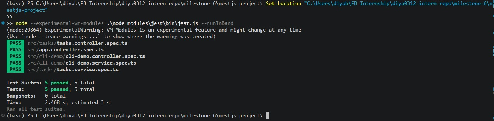

# Writing Unit Tests for Services & Controllers in NestJS

- **Milestone:** 9  
- **Issue:** #22  
- **Date:** 18/10/2026  

## Objective

- Learn how unit testing works in NestJS using Jest.
- Write and understand unit tests for a NestJS service.
- Write and understand unit tests for a controller.
- Learn how to mock dependencies using NestJS testing utilities.

## 1. Unit Testing in NestJS

- Unit testing checks a small part of an application separately from the rest of the system.
- In NestJS, services usually contain business logic, while controllers handle incoming requests and call services.
- Jest is used to run tests and check whether the actual results match the expected results.
- The `describe()` function groups related tests.
- The `it()` or `test()` function defines an individual test case.
- The `expect()` function checks the result of an operation.

## 2. Writing Unit Tests for Services

- A service test checks the behaviour of a service method.
- Tests can provide sample inputs and verify the returned values or expected behaviour.
- Testing a service separately makes it easier to identify problems in its business logic.
- Dependencies can be mocked when the test does not need to interact with real external components.

- The screenshot above shows the service test code used in this project.

## 3. Writing Unit Tests for Controllers

- A controller test checks how a controller behaves when its methods are called.
- It can verify whether the controller returns the expected result or calls the appropriate service method.
- Mocking the service allows the controller to be tested without running the real service implementation.
- This helps identify whether a problem is in the controller or in the service.

- The screenshot above shows the controller test code used in this project.

## 4. Mocking Dependencies

- Mocking replaces a real dependency with a controlled test version.
- A mock can return a chosen value or allow a test to verify whether a method was called.
- Jest provides functions such as `jest.fn()` for creating mock functions.
- NestJS testing utilities allow mock dependencies to be registered as providers in a testing module.
- Mocks help keep unit tests focused on the component being tested.
- They also reduce reliance on databases, network calls, and other external services.

## 5. Running Tests with Jest

- Jest runs the test files and reports which tests pass or fail.
- Test results help identify problems before code changes are integrated.
- The screenshot below should show the actual test output from this project.
- Only tests confirmed as passing in the terminal should be reported as successful.

## 6. Reflection

### Why is it important to test services separately from controllers?

- Services contain business logic, while controllers handle requests and communicate with services.
- Testing them separately helps identify which component is causing a problem.
- It also makes tests easier to understand and maintain.
- Service tests can focus on business logic, while controller tests can focus on request handling and service interaction.

### How does mocking dependencies improve unit testing?

- Mocking replaces real dependencies with controlled versions.
- It allows a component to be tested without relying on databases, network services, or other components.
- Tests become more isolated and predictable.
- Mocks also make it easier to simulate different return values and error conditions.

### What are common pitfalls when writing unit tests in NestJS?

- Forgetting to register required providers in the testing module.
- Mocking a dependency incorrectly or failing to configure its return value.
- Testing implementation details instead of observable behaviour.
- Not handling promises or other asynchronous operations correctly.
- Writing tests that depend on shared state or the order in which tests run.
- Testing only successful cases and ignoring errors or invalid inputs.

### How can you ensure that unit tests cover all edge cases?

- Identify normal inputs, boundary values, invalid inputs, and possible error conditions.
- Write separate test cases for important scenarios.
- Check both expected return values and relevant side effects.
- Use mocks to simulate dependency failures where appropriate.
- Review the requirements and use code coverage reports as an additional check.
- Remember that high code coverage alone does not guarantee that every important behaviour is tested.

## 7. Conclusion

- Unit tests help verify individual services and controllers in isolation.
- Jest provides the test runner, assertions, and mocking functions.
- NestJS testing utilities help configure modules and provide mock dependencies.
- Separate tests make failures easier to locate and help prevent regressions.
- The actual test output should be used to record which tests passed or failed.
