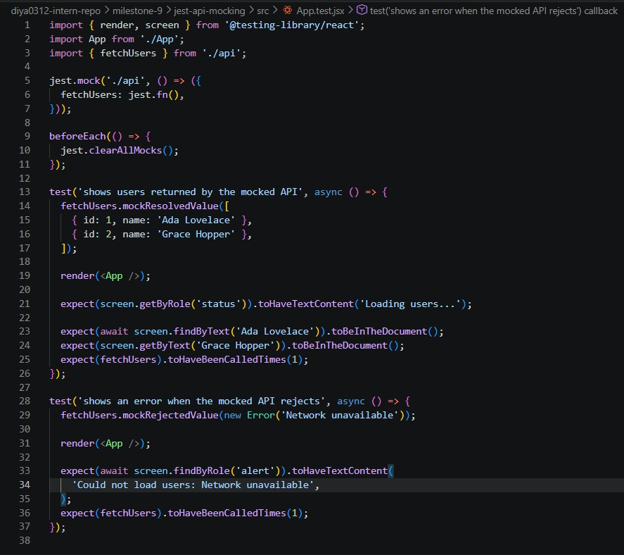
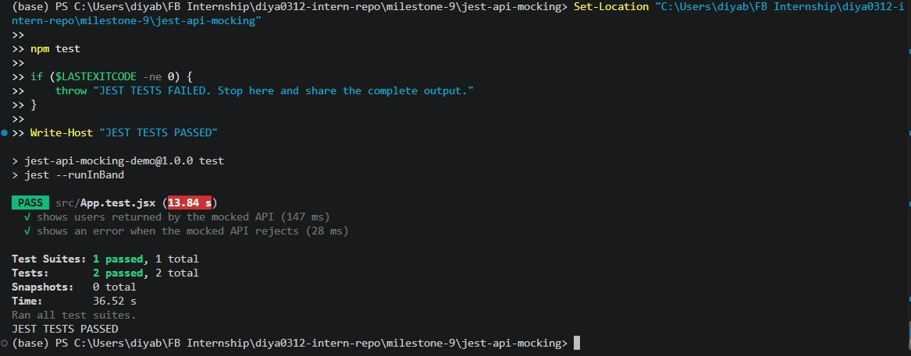
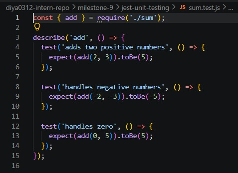
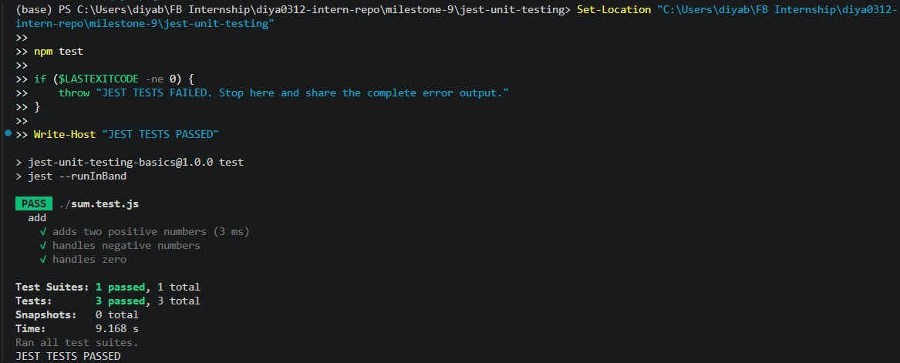

# Mocking API Calls in Jest

**Milestone:** 9  
**Issue Number:** #77  
**Date:** 12/10/2026

## Objective

Learn how to mock API calls in Jest and test asynchronous React component behaviour without making real network requests.

## Implementation

Created a React component that fetches and displays user data through a separate API function. Added Jest tests that mock the API function and verify both successful responses and errors.

The implementation uses:

- `jest.fn()` to create a mock function.
- `jest.mock()` to replace the API module in tests.
- `mockResolvedValue()` to simulate a successful asynchronous API response.
- `mockRejectedValue()` to simulate an API failure.
- React Testing Library to render the component and check what users see.
- Asynchronous queries to wait for the expected UI to appear.

## How does API mocking work in Jest?

`jest.fn()` creates a mock function that can record calls and return configured values. `jest.mock()` allows a dependency or module to be replaced during testing so that the test does not depend on the real implementation.

For asynchronous code, `mockResolvedValue()` simulates a resolved promise, while `mockRejectedValue()` simulates a rejected promise. This lets tests check success and failure behaviour in a controlled and repeatable way.

## React component and mock setup

The component displays a loading message while the request is pending, lists users after a successful response, and displays an error message if the request fails.

The test replaces the API module with a mock function and configures different responses for each test.

## Testing and Verification

The test suite checks that:

1. The loading message appears while the request is pending.
2. User names are displayed after a successful response.
3. The API mock is called exactly once.
4. An error message appears when the mocked API request rejects.

The tests were run with `npm test`. The screenshot below should be treated as evidence of success only if the command completed with both tests passing.

## Common pitfalls when testing asynchronous code

- Not awaiting asynchronous assertions can cause a test to finish before the expected UI appears.
- Calling a real API in a unit test makes the test slower and dependent on network availability.
- Forgetting to reset mocks can cause call counts or mock behaviour to leak between tests.
- Testing only successful responses leaves error handling unverified.
- Using assertions that do not wait for state updates can lead to flaky tests.

## Reflection

Mocking API calls is important because it allows tests to run without relying on external services, network availability, or changing server data. It makes tests faster, more predictable, and easier to repeat. It also allows success and failure scenarios to be tested without having to manipulate a real server.

One common pitfall when testing asynchronous code is failing to wait for a promise or UI update before making assertions. This can cause tests to fail intermittently or finish before the expected result appears. Other pitfalls include accidentally making real network requests, failing to reset mocks between tests, and testing only the success path. Using asynchronous queries and clearing mocks between tests helps avoid these problems.

---

# Issue #76 — Introduction to Unit Testing with Jest

**Milestone:** 9  
**Issue Number:** #76  
**Date:** 12/10/2026

## Objective

Learn what Jest is, understand why unit testing matters, set up Jest, and write tests for a simple utility function.

## What is Jest?

Jest is a JavaScript testing framework used to run tests and check whether code behaves as expected. It provides test functions such as `test()` and `describe()`, along with assertions such as `expect()`.

## Why are unit tests important?

Unit tests check small, individual pieces of code in isolation. They help detect mistakes early, make behaviour easier to verify, and reduce the chance of regressions when code changes.

## Implementation

Created a utility function named `add` that returns the sum of two numbers. Jest tests check positive numbers, negative numbers, and zero.

The test file uses:

- `describe()` to group related tests.
- `test()` to define each test case.
- `expect()` and `toBe()` to compare actual and expected results.

## Test Code

The `sum.js` file contains the utility function, and `sum.test.js` contains the test cases.

## Testing and Verification

The test suite was run using `npm test`. The screenshot below should be treated as evidence of success only if all three tests completed successfully.

## Reflection

Automated testing is important because it checks whether software behaves as expected without requiring every check to be performed manually. It can detect regressions when code changes, improves confidence in small components, and makes failures easier to identify.

The challenging part of writing my first Jest test was understanding how to structure a test and compare the actual result with the expected result. Using `test()` to define the scenario and `expect()` with `toBe()` to check the result made the process easier to understand. Testing normal values, negative numbers, and zero also helped me consider different inputs rather than checking only one example.
